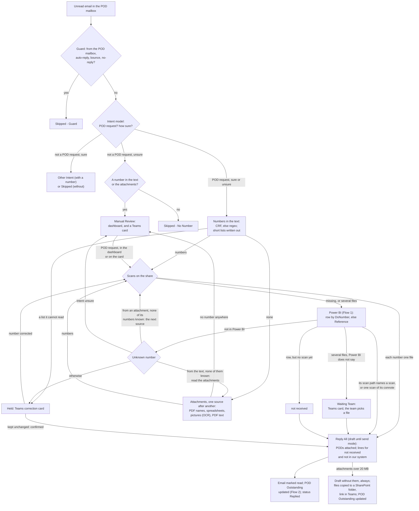

# POD Email Agent

The agent answers Proof of Delivery (POD) requests that customers send to a
shared Outlook mailbox. For each new email it decides whether the sender
wants a POD, finds the connote and reference numbers in the text or the
attachments, looks for the signed scans on the network share, and asks
Power BI about the numbers it cannot find. Then it drafts one Reply All with
every POD it found. A person steps in through Microsoft Teams when the agent
cannot decide on its own.

## Highlights

- **Built for a locked-down PC.** No database or API access, restricted
  outgoing internet: the agent runs locally in Python and reaches the cloud
  only through Power Automate flows that trade JSON files with it.
- **Two models trained on the team's own emails.** XGBoost on TF-IDF
  features decides whether an email asks for a POD; a CRF, backed by a
  regex, finds the connote and reference numbers. Both are scored by 5-fold
  cross-validation, and a person chooses which one runs.
- **Never guesses.** An unknown or ambiguous number holds the email and
  asks the team on a Teams card; replies stay drafts until the product owner
  switches sending on.
- **Tested without the real systems.** 391 automated tests and a 34-scenario
  end-to-end simulation run against a fake Outlook and fake flows; GitHub
  Actions runs both on Windows with Python 3.13 and 3.14.
- **Every choice written down.** 61 numbered decisions, each with its
  context and consequences, in `docs/DECISIONS.md`.

| Area | Tools |
|---|---|
| Language and runtime | Python 3.14 on Windows, Task Scheduler |
| Email | Outlook Desktop through COM (`pywin32`) |
| Machine learning | scikit-learn (TF-IDF), XGBoost, sklearn-crfsuite (CRF) |
| Attachments | pypdf, pypdfium2, Windows OCR, openpyxl, xlrd |
| Data and dashboard | SQLite, pandas, Streamlit, Altair |
| Integration | Power Automate, Power BI (DAX), Excel Online, Teams adaptive cards, SharePoint |
| Quality | unittest, an end-to-end simulation, GitHub Actions |

## Why it is built this way

The agent runs on an ordinary office PC used by the administration staff.
That PC has no special rights and restricted to some outgoing internet access, but
it runs Python. The agent therefore runs locally and reaches its data
through what the PC already has:

| Data | How the agent reaches it |
|---|---|
| The POD mailbox | Outlook Desktop, through `pywin32` |
| The signed scans | The network share |
| Consignments and POD status | Power BI online, through Power Automate flows that trade one JSON file per message with the agent in a synced SharePoint folder |
| The team | Microsoft Teams cards, posted by the same flows |

The models (an XGBoost intent classifier and a CRF that tags numbers) train
and run on the PC's CPU.

## How it works, from email to reply



The agent keeps one tracking event per step of each email. The latest event
says where the email stands, so each run picks up where the last one
stopped, and an email that waits for Power BI or the team holds up no other.
A run has two parts, and you can schedule them apart:

- **Intake** (`--process-new`) takes new unread emails through the flow above.
- **Resume** (`--resume`) reads Power BI answers, Teams answers and dashboard
  reviews, and posts again any Teams card that never arrived. It resolves,
  with no draft, an email a person already answered or filed in Outlook. It
  then records what became of each draft (sent with the same PODs, sent with
  PODs changed, deleted), adds Outlook categories, and files finished emails
  when you switch that on.

| Outcome | What happens |
|---|---|
| Replied | One Reply All draft (or sent email) with every POD found. Numbers not received yet and numbers not in the system each get a line, and the POD Outstanding list gets their rows. |
| Waiting Power BI / Waiting Team | A Power BI request or a Teams card is open; the resume part carries on once it has its answer. |
| Held | The team must act; the reason and a Teams message or card say why. |
| Manual Review | A person decides, in the dashboard or on the Teams card; the next run carries on with a POD request. |
| Other Intent, Skipped | No reply. |
| Resolved | A person handled it, in Outlook or the dashboard. |

`docs/ARCHITECTURE.md` gives every rule in detail, and `docs/DECISIONS.md`
the reason behind each. `docs/SIMULATION.md` runs every path above with
dummy data.

## The dashboard

The product owner runs the agent from a Streamlit dashboard on the same PC
(http://localhost:8501, reachable from that PC only). It has seven tabs,
and a sidebar to choose the active models and refresh the page.

To see it without Outlook or real data, run
`python -m sim.run --dashboard`: it opens the dashboard on a month of
dummy emails, labels and trained models (`docs/SIMULATION.md`).

| Tab | What you can see and do |
|---|---|
| **Overview** | Figures for today and the last 7 days: emails received, POD requests, replies with files, replies with a POD missing, emails held for the team, and Manual Review. The pilot measure: the share of drafts sent with exactly the PODs the agent attached, against its target. Charts of emails per day by outcome, the outcome of each requested number, the weekly share of numbers found on the share, how often the product owner left the agent's decisions unchanged, the top requesting domains, and how long POD emails have waited. Each chart has its data table. |
| **Review queue** | The emails waiting for Power BI or the team, or needing a person, with their reason and age. A person can review them one by one in a pop-up (choose the intent, correct the numbers), mark them resolved, or process them again. A warning appears when a flow did not answer after 3 tries, with buttons to send the request or the Teams card again. |
| **History** | Every email the agent processed, with filters by status, outcome, sender and date. Opening one shows each step the agent took: statuses and reasons, files found or chosen, Power BI results, reviews, attachments read, the draft's outcome and the reply text. From there an email can go into the training data. |
| **Labeling** | The training data in an editable table, with search and filters. Label rows in bulk, confirm the agent's suggestions, or go through emails one by one in a pop-up that shows the whole email, highlights every number found, and offers the model's suggestion. |
| **Models** | Each training run's scores per model: accuracy, precision, recall, F1 and a confusion matrix. For the intent model, a chart of precision and coverage at every confidence threshold. Choose here which model the agent uses. |
| **Jobs** | Buttons to run one agent cycle, pull new data, run the historical pull, train the models, and let the models suggest labels. Output and progress show live, and only one job runs at a time. |
| **Settings** | The confidence threshold, with its precision against the target; the two targets; automatic replies (Off, Partial for chosen domains, or Full, asking first before more replies go out); moving finished emails to a folder; the emergency stop; auto-refresh; and the other settings, read-only. |

## Documentation

Read them in this order: the PRD for why the system exists, then the
architecture for how it works. The last three are references to look up as
needed.

| # | File | Holds |
|---|---|---|
| 1 | `docs/PRD.md` | Requirements: the problem, goals, users, scope |
| 2 | `docs/ARCHITECTURE.md` | How the system works: data flow, modules, settings |
| 3 | `docs/CLASSIFIER.md` | The two classifiers: intent and numbers, their input, models, decisions and training |
| 4 | `docs/POWER_AUTOMATE_FLOW.md` | The three Power Automate flows: what each does, its files and a diagram |
| 5 | `docs/RUNBOOK.md` | Install, run, schedule, stop, undo, fix |
| 6 | `docs/TEST.md` | The three kinds of testing, and the stages of testing in production |
| 7 | `docs/SIMULATION.md` | The simulation: every scenario and what it checks |
| 8 | `docs/HANDBOOK.md` | Reference: facts about the environment, design rules, security |
| 9 | `docs/DECISIONS.md` | Reference: numbered decisions (D-001 to D-061), each with its context and consequences |
| 10 | `docs/PROGRESS.md` | Reference: the build log and known gaps |

## Project layout

- `app/`: the agent
- `dashboard/`: the Streamlit dashboard
- `tests/`: automated tests
- `sim/`: the simulation, with a fake Outlook, fake flows and dummy data
- `docs/`: the documentation
- `data/`, `models/`, `logs/`: local data, trained models and run logs (git ignores them)

## Getting started

Run these from the project folder, in PowerShell, on a Windows PC with
Outlook Desktop signed in to the POD mailbox.

### 1. Install and configure

```powershell
python -m venv .venv
.\.venv\Scripts\python -m pip install -r requirements.txt
Copy-Item .env.example .env
```

Fill in every `<...>` in `.env`; `docs/ARCHITECTURE.md` section 6 explains
each setting. Then check them:

```powershell
python -m app.check_setup
```

`POD_OUTLOOK_MAILBOX` must match the mailbox name at the top of Outlook's
folder list, such as `POD`. The agent never falls back to your own Inbox.

### 2. Pull past emails to label

```powershell
python -m app.historical_pull
```

The pull exports up to `POD_HISTORICAL_EMAIL_LIMIT` (2,000 by default)
emails from the last year that contain a number, into the training workbook
(`POD_TRAINING_DATA_FILE`). It keeps only each email's newest message. Label
them in Excel or the dashboard: `intent_label`, `connotes_manual` and
`reference_number_manual`.

A master number list (`POD_MASTER_NUMBER_DATA`, an `.xlsx` or `.csv` with
columns `DoNumber` and `Reference`) labels numbers for you: matches go to
`connote_number_auto` and `ref_number_auto`, leading zeros kept. Leave the
setting empty to skip it.

To refresh rows already in the workbook and keep their labels:

```powershell
python -m app.historical_pull --update
```

### 3. Train and choose the intent model

```powershell
python -m app.classifier
python -m app.model_registry --task intent --activate xgboost
```

Training scores each model with 5-fold cross-validation, so a model never
predicts an email it trained on. It prints accuracy, macro precision,
recall and F1, saves each model to `models/classifier_model_<name>.pkl`, and
records the run in `models/history/`. XGBoost is the model to use; Logistic
Regression serves as a yardstick. If XGBoost ever drops to its level, check
the data.

Training activates no model: you choose one. Until you do, the agent runs
in cold start and sends every email with a number to manual review.
`python -m app.model_registry` shows the current choice.

To let the active model suggest labels for unlabeled rows, which you then
confirm in the dashboard:

```powershell
python -m app.classifier --pseudo-label --threshold 0.95
```

### 4. Train and choose the number model

```powershell
python -m app.train_number_classifier
python -m app.model_registry --task number --activate crf
```

The CRF tags each candidate token as `CONNOTE`, `REFERENCE` or `OTHER` from
the subject, the newest message and the words around it. It trains on rows
labeled `POD_REQUEST` with numbers filled in, and the run compares it with a
regex extractor email by email. To use the regex alone:

```powershell
python -m app.model_registry --task number --activate regex
```

The agent also falls back to the regex when the CRF finds nothing. To let
the CRF suggest number labels (your own labels stay as they are):

```powershell
python -m app.train_number_classifier --pseudo-label
```

### 5. Run the agent and the dashboard

```powershell
python -m app.main
streamlit run dashboard/app.py
```

`python -m app.main` runs one cycle, intake and resume together, and prints
its progress. To schedule the two parts apart in Task Scheduler (intake
every five minutes, resume every minute):

```powershell
python -m app.main --process-new
python -m app.main --resume
```

`docs/RUNBOOK.md` covers Task Scheduler, stopping the agent and `--reset`.
Replies stay drafts until you choose partial or full sending in the
dashboard. A file named `STOP` in the project folder stops every run.

Open the dashboard at http://localhost:8501; only this PC can reach it. Its
seven tabs refresh every 30 seconds; "The dashboard" above describes each.

### 6. Test

```powershell
python -m unittest discover -s tests
python -m sim.run
```

The tests need no Outlook, network share or Power Automate. The simulation
runs every scenario through the real agent with dummy data. GitHub runs
both on Windows with Python 3.13 and 3.14 for every push to `main`.
`docs/TEST.md` explains both, and the stages of testing in production.

## Use of generative AI

I used generative AI tools as an assistant while building this project. I set the requirements, made the decisions
recorded in `docs/DECISIONS.md`, reviewed the changes, and tested the agent
against the real mailbox, share and flows.
