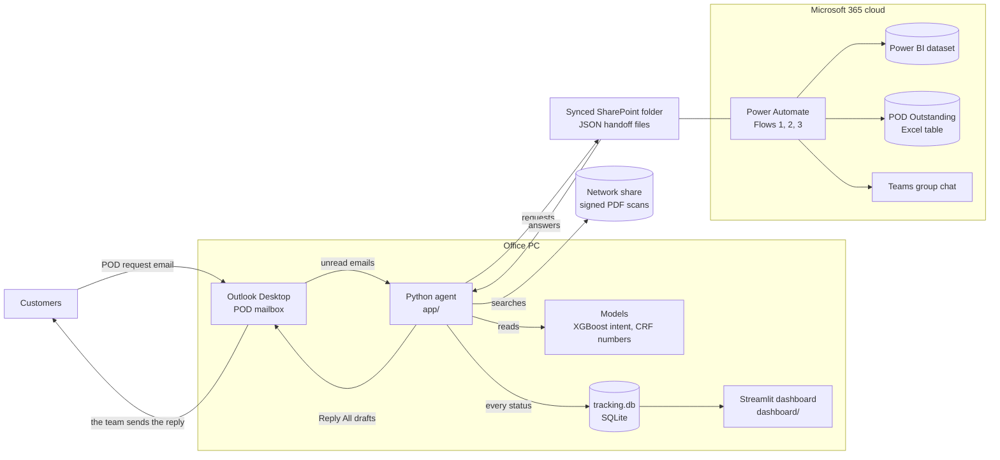
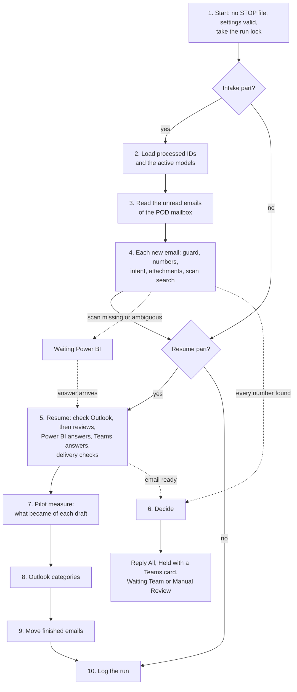

# Architecture

This file describes the agent as the code runs it now. Section 1 gives the
whole system on one screen; sections 2 to 8 are the detailed reference.
`docs/DECISIONS.md` holds the reasons, and `docs/PROGRESS.md` the known
gaps. Change this file in the same commit as the code it describes.

## 1. At a glance

| Part | Job |
|---|---|
| Outlook Desktop | The only way into the mailbox: the agent reads emails and writes Reply All drafts through it. |
| Python agent | Every business rule: the guard, numbers, intent, scan search, decisions, replies (sections 2 and 4). |
| Models | XGBoost decides whether an email asks for a POD; a CRF, backed by a regex, finds the numbers. |
| Network share | The signed PDF scans, searched by the numbers in their file names. |
| SharePoint folder and Power Automate | The bridge to the cloud: one JSON file per message, three flows that carry no logic (section 8). |
| Power BI, POD Outstanding, Teams | Consignment data, the list of PODs still owed, and the team. |
| SQLite and the dashboard | One status row per step of each email; the dashboard reads them for review, labeling and training (section 7). |

### In one paragraph

A Python program on a Windows PC reads the unread emails of the POD shared
mailbox through Outlook Desktop (COM, `pywin32`). It skips automatic and
self-sent mail and pulls out the connote and reference numbers; an email
without any gets skipped. A model the product owner chose sorts the rest
into `POD_REQUEST` or `OTHER`. For a POD request, the agent searches the
scanned PDFs on the network share and asks Power BI, through a Power
Automate flow, about the numbers with no scan. It then writes one reply per
email, a draft during the pilot, with every scan it found and the numbers
not received yet, and asks Power Automate to update the POD Outstanding
list. When the agent is unsure, it holds the email and tells the team in
Teams. Python and Power Automate trade small JSON files in a synced
SharePoint folder, and nothing else. A local SQLite file records each
email's status, and a Streamlit dashboard serves labeling and monitoring.

## 2. Runtime flow

### `python -m app.main` (scheduled)

`app/main.py: run()` does one cycle. The intake part (`--process-new`)
runs steps 2 to 4, the resume part (`--resume`) runs steps 5, 7, 8 and 9,
and both use step 6. A plain run does both, intake first.

Solid arrows show the order of one cycle; dotted arrows show where a
single email goes. An email that waits for Power BI or the team leaves the
cycle and comes back through step 5 on a later run.

#### 1. Start

If a `STOP` file exists in the project folder, the cycle stops at once and
reads, drafts and sends nothing. A setting that is missing or malformed
stops it too, before any email. Then the cycle takes the run lock
(`data/run.lock`). When another cycle holds it, an intake run retries every
5 seconds for up to 2 minutes; a resume run gives up at once.

#### 2. Load

The cycle loads the processed entry IDs (`data/processed_ids.txt`), the
training data, and the active intent and number models
(`model_registry.load_active`, section 4). It runs in **cold start** when no
intent model is chosen, or when an intent class has fewer labels than
`POD_MIN_TRAINING_SAMPLES_PER_CLASS`.

#### 3. Read the mailbox

`outlook_reader.get_unread_emails` reads the **unread** emails at the root
of `POD_OUTLOOK_MAILBOX`, oldest first, and skips processed IDs (D-002). It
cuts the body to the newest message and keeps the whole body as
`full_body` (D-017).

#### 4. Each new email (`_process_new_email`)

The agent marks the ID processed afterwards. It judges the intent first, as
a person would (D-044).

1. **Guard** (`skip_reason`). These become `Skipped - Guard`: mail sent by
   the POD mailbox or on its behalf (the team's replies come back through
   CC, D-055), auto-replies, bounces, no-reply senders and automatic
   subjects.
2. **Numbers in the text.** The CRF finds them, else the regex. Short lists
   such as `7335842/843` get written out (`number_classifier.extract_numbers`,
   D-026, D-034).
3. **Cold start.** With a number: `Manual Review`. Without: `Skipped - No
   Number`.
4. **Intent.** The intent model runs on every email, and
   `POD_CONFIDENCE_THRESHOLD` says whether it is sure.
   - `OTHER`, sure. With a number: `Manual Handling - Other Intent`.
     Without: `Skipped - No Number`.
   - `OTHER`, unsure. A number in the text or the attachments: `Manual
     Review`. None: `Skipped - No Number`.
   - `POD_REQUEST`, sure or unsure. The agent keeps "unsure" as
     `state["intent_unsure"]`. A number list it cannot read: `Held`, with a
     correction card (D-034, D-036).
5. **Attachments** (`attachments.read`), when the text holds no number. The
   agent reads one source after another: PDF names, the connote and
   reference columns of spreadsheets (D-046), pictures through Windows' own
   OCR, and PDF text. It uses the first source with numbers. The others wait
   in `state["number_sources_left"]`, and the agent turns to them only when
   none of the first source's numbers is on the share or in Power BI. No
   number anywhere: `Manual Review`. Files left unread because of the
   limits, and no number: `Held`.
6. **Scan search.** The agent builds the scan index once per run, only when
   it needs it. Each number is FOUND (one file), AMBIGUOUS (several) or
   MISSING (none) (D-003).
   - A file matches when a whole part of its name is the number:
     `1234567_80655501 - Signed (2)` holds 1234567 and 80655501.
   - A scan with the word "Signed" wins over one without. Unsigned scans
     stay out of the index (D-042).
   - For a sender in `POD_SENDER_FOLDERS`, only files in its folder count.
     A match found only elsewhere is AMBIGUOUS, and its Teams card says the
     file is not in that folder.
   - Every number FOUND: on to Decide (step 6), with no Power BI question
     (D-044).
7. **Power BI request**, when a number is MISSING or AMBIGUOUS. The request
   holds every requested number and a `scan_missing_numbers` subset (the
   missing and ambiguous ones). The DAX query checks only that subset
   against connotes and references, leading-zero variants included.
   - The agent matches a row by connote (DoNumber) first, else by reference
     (D-044). When a reference matches, the agent also searches the row's
     connote in the scan index, and can attach that scan for the requested
     number.
   - A row's scan path (`POD_PBI_SCAN_PATH_COLUMN`, a path or file URI)
     that names a PDF indexed under `POD_SCAN_FOLDERS` gives the scan, for
     every sender. Rows of a sender in `POD_PBI_SENDER_CHECK` count only
     when their sender column holds that sender's word (D-044). A missing
     path, or one outside the scan roots, falls back to the connote lookup.
   - The email becomes `Waiting Power BI`. Each request has its own id
     (`<request id>-p<n>`, `state["pbi_request"]`), so the agent reads only
     the answer to the current one (D-040).
8. **Errors.** An exception gives `Error` with the reason. When the agent
   cannot read the scan folders, the run stops before the email, which stays
   unprocessed for the next run.

#### 5. Resume

**Check Outlook first** (`_check_outlook`). The agent looks up each email
in Waiting Power BI, Waiting Team, Held, Reviewed, Manual Review or Other
Intent:

- A person answered it (Outlook's "You replied" mark, Reply or Reply All):
  `Resolved`, "replied manually in Outlook" (D-039).
- Moved to `POD_FINISHED_FOLDER` (found by its Internet Message ID after the
  move): `Resolved`.
- A POD request moved elsewhere or deleted: `Held`.
- An Other email moved anywhere: `Resolved` (D-041).

The agent archives that email's open Teams cards and Power BI files. It runs
the same check right before every reply (`_reply`), and sends nothing when
Outlook cannot tell.

**Reviewed** (`_resume_reviewed`). A person decided in the dashboard's
Review queue that the email is a POD request, and gave its numbers
(`main.record_review`, under the run lock, D-047). The scan search and the
Power BI request of step 4 run with those numbers; the model's view no
longer counts. A review saved without numbers sends the agent to the
attachments, as in step 4 (D-046). A person's OTHER becomes `Reviewed -
Other`, and the agent sends nothing.

**Waiting Power BI** (`_resume_pbi`), once the result has arrived. The agent
archives the request and the result. An error gives `Held`. Otherwise:

- The agent matches each missing number to a row by connote or reference,
  leading-zero variants included. When the row's connote has a scan, the
  agent uses that scan.
- For rows that qualify for the scan path, the agent tries the Power BI path
  first. Several eligible files go to the team to choose. When the file is
  not under the scan roots, the agent falls back to the connote lookup.
- Every other number is NOT_RECEIVED or UNKNOWN.
- When every number from the email's text is UNKNOWN and none came from a
  person's review, the agent reads the attachments as in step 4 (D-056).
  If they give no known number, it holds the text's numbers as before.
- Numbers from an attachment: if another number of that source is settled,
  the agent drops the unknown ones (and the text's). If none is, it searches
  the next source (step 4), and keeps `intent_unsure` and the review.

Then the agent decides (step 6).

**Manual Review** (`_to_manual_review`, D-048). Every email that goes to
Manual Review, except at cold start, gets a Teams review card: its first 500
characters, a Connotes field filled with its numbers, an empty References
field, and three buttons: POD request, Not a POD request, Handle manually.
Once someone answers the card (`_resume_manual`):

- POD request: `Reviewed`, with those numbers, or with none to read the
  attachments.
- Not a POD request: `Reviewed - Other`.
- Handle manually: the email stays, with no card.
- An answer without `references` comes from an old Flow 3, and the agent
  ignores it.

A dashboard review, Mark resolved or Process again withdraws the card file
(`_withdraw_cards`).

**Waiting Team** (`_resume_team`), with new card answers. "Handle manually"
gives `Held`. The agent records a file or "all" as the choice.

**Held** (`_resume_held`, D-036), with a correction card answered. Saved
numbers give `Reviewed`, as from the dashboard, and the agent continues it
in the same run. "Handle manually" keeps it `Held`. An answer with no usable
numbers gets a new card. Only holds for an unknown number or an unreadable
number list get that card; other holds get a plain message.

Every Teams card has an "Open the POD mailbox" button that opens the POD
mailbox in Outlook on the web (`handoff.pod_mailbox_url`, D-051, D-061).

**Delivery checks.**

- A Teams card (file choice or correction) that has not reached Teams 30
  minutes after the agent wrote it gets written again under a new id. Its
  file is still in `teams/`, or Flow 3 reported an error. The agent
  archives the old file. After 3 resends the Review queue shows the card to
  a person (`_check_delivery`, D-037). Waiting for an answer records no
  event.
- The agent archives files in `teams/` that no open card needs after 30
  minutes.
- A Power BI request with no result after 30 minutes gets written again
  under a new id, at most 3 times. Then the Review queue shows it, so a
  person can check Flow 1 (`_check_pbi_answer`, D-049).

#### 6. Decide (`_decide`)

- Any UNKNOWN in an unsure POD request: `Manual Review`, with its review
  card (not the correction card), and no POD Outstanding row (D-044).
- Any UNKNOWN otherwise: the agent adds each UNKNOWN and each NOT_RECEIVED
  number to POD Outstanding. An UNKNOWN row has the status `Not in The
  System` and the requested number as its connote; numbers from attachments
  get no row. The email becomes `Held`, with a Teams card that asks the team
  to check and correct the unknown numbers (D-006, D-023, D-036). UNKNOWN
  numbers a person saved unchanged in a review are not held again: they go
  into the reply as not in our system and keep their row (D-045).
- Any AMBIGUOUS without a team choice: one Teams choice card per number,
  and `Waiting Team`.
- Otherwise, reply (`_reply`):
  1. Refuse attachments outside the scan folders.
  2. Attachments over `POD_MAX_ATTACHMENT_MB` in total: a draft without
     them, whatever the send mode, and the files copied for the team
     (D-050).
  3. Build the Outstanding rows. A wrong column map fails here, before any
     reply.
  4. Write one Reply All in the original conversation. It carries every
     FOUND or chosen file (a file found for two numbers goes once, D-047),
     the NOT_RECEIVED numbers and the numbers not in our system (D-045).
     The POD mailbox goes in CC, never in To (D-055).
  5. Open the email in the POD mailbox (its StoreID). In draft mode, move
     the draft to the "Drafts" folder found by name under that mailbox's
     root, and fail with where the draft went if that folder is missing
     (D-032). Drafts leave out the automated-email notice. In send mode the
     agent sends the reply with the notice, from
     `POD_SHARED_MAILBOX_ADDRESS`, as `POD_SEND_MODE` says. Partial mode
     sends only to senders of `POD_SEND_DOMAINS` (`config.reply_mode`,
     D-057).
  6. Format the reply with the signature in `POD_SIGNATURE_FILE`, keep
     Outlook's quoted HTML trail from its separator line, and leave out the
     personal reply signature.
  7. Mark the email read. Ask Flow 2 to remove FOUND numbers from
     Outstanding and add the NOT_RECEIVED and not-in-system numbers.
     `Replied`.
- Held emails stay unread (D-002).

#### 7. Pilot measure (`_check_drafts`, D-014)

For each draft without an outcome, the agent looks in the POD mailbox's and
the user's Sent Items for the first reply in the same conversation sent
after the draft. It records a new Replied event (`app/pilot.py`):

- `draft sent, same PODs`: exactly the PDFs the agent attached, whatever the
  text (D-053);
- `draft sent, PODs changed`;
- `draft deleted`.

A failure here never stops the run.

#### 8. Outlook categories (`_check_email_categories`)

The agent adds `POD Agent Reply` once a tracked draft goes out. It adds `On
List` once Flow 2 has moved every expected Outstanding `add` file for that
email from `outstanding/` to `archive/`. It keeps the categories the email
already has. The synced SharePoint folder must show Flow 2's archive move
before the next scheduled run. An email moved by hand gets a new entry ID,
so the agent finds it by its Internet Message ID
(`outlook_reader.find_by_message_id`, D-059), as in step 9.

#### 9. Move finished emails (`_move_finished`, D-031)

With the dashboard switch on, a `Replied` email moves to
`POD_FINISHED_FOLDER`, directly under `POD_OUTLOOK_MAILBOX`, when:

- every POD went with the reply (no number not received), and
- the reply went out after the switch was turned on. The time is
  `sent_at`: when the agent sent it, or when Sent Items shows the draft
  went out.

Each email moves once. The agent logs a failure and tries again next run.

#### 10. Log

The cycle appends a one-line summary to `logs/run_log.txt`, in local time
(`YYYY-MM-DD HH:MM:SS UTC+8 ...`). A resume-only run writes a line only when
it did something. Tracking keeps UTC.

### Status log

`app/tracking.py` writes one row per status event to `data/tracking.db`, a
local SQLite file read through Python's standard library (D-010). An
email's latest row gives its status (`tracking.latest`). Each row carries
the email fields, numbers, intent, confidence, a reason and the working
state: found files, Power BI rows, Teams cards and choices, reply text.
`tracking.py` defines the status names as constants.

## 3. Bootstrap and training (run by hand)

| Step | Command | What it does |
|---|---|---|
| Pull history | `python -m app.historical_pull [--update]` | Reads the last 365 days of every email folder under the mailbox, except Drafts, Deleted, Sent and Junk, and skips calendars and contacts. It lists each folder through Outlook's table and names it as it goes (D-059), newest first, up to `POD_HISTORICAL_EMAIL_LIMIT`, and takes each email once by its entry ID (D-058). It keeps the emails with a number and writes them to the training workbook (`POD_TRAINING_DATA_FILE`), keeping the manual and pseudo-label columns already there by `entry_id`. |
| Train intent | `python -m app.classifier` | TF-IDF (1-2 grams) + `xgboost` (the intent model) and `logreg` (its yardstick, D-024), scored by stratified 5-fold cross-validation, then each fit on all data. Saves each as `models/classifier_model_<name>.pkl` and writes a history record (section 4). Activates nothing. |
| Choose model | `python -m app.model_registry --task intent\|number --activate <name>` | Records the product owner's choice in `models/active.json`. Refuses unknown names and untrained models. Without options, prints the current choice. The dashboard sidebar does the same. |
| Intent pseudo-labels | `python -m app.classifier --pseudo-label --threshold 0.95` | With the active intent model, for rows without a manual label, writes the prediction to `intent_label_pseudo` (blank below threshold), `pseudo_confidence`, and `pseudo_verified=False`. |
| Train numbers | `python -m app.train_number_classifier` | Takes the `POD_REQUEST` emails with `connotes_manual` or `reference_number_manual` filled in, tags every token CONNOTE / REFERENCE / O, and cross-validates a CRF against regex (5 folds split by email), keeping per-email scores (exact, precision, recall, requests without a number) and per-token scores, plus the saved CRF's scores on its own training emails (train vs test shows over- or underfitting). Saves the CRF fit on all emails as `models/number/model_crf.pkl` and writes a history record. Activates nothing. |
| Number pseudo-labels | `python -m app.train_number_classifier --pseudo-label` | With the active CRF, writes `connotes_pseudo`, `reference_number_pseudo` and confidences for rows without a manual intent. |

Where a row has no manual label, training takes a verified pseudo-label
(`pseudo_verified` true) instead (`classifier.load_training_data`).

`historical_pull` also fills in hints:

- `intent_label_auto`: `POD_REQUEST` when the POD mailbox address is a
  recipient; `CHECK` when "POD" is a recipient and the email sits outside
  the `Actioned/Finished` folder; `OTHER` otherwise, and for senders in
  `POD_SKIPPED_SENDER_EMAILS`.
- `connote_number_auto` and `ref_number_auto`: from the master number list
  (`POD_MASTER_NUMBER_DATA`, columns `DoNumber` and `Reference`), else the
  regex.

## 4. Models and number extraction

`docs/CLASSIFIER.md` explains both classifiers for a first read, with
examples and diagrams; this section is the reference.

**Choice and history** (`app/model_registry.py`, D-011):

- `models/active.json` holds the chosen model per task, such as
  `{"intent": "xgboost", "number": "crf"}`. With no file or no entry, no
  model is chosen: intent runs in cold start, and numbers use the regex.
- Every training run writes `models/history/<UTC timestamp>_<task>.json`.
  It holds the training file, the evaluation method, the labels, every
  example's label, and per model the metrics (accuracy, macro and
  per-class precision, recall and F1, confusion matrix) with each example's
  prediction and confidence. The dashboard can then score any confidence
  threshold later.
- Scores are out-of-fold (D-022, `model_registry.cross_validate`): 5 folds,
  and a model that never saw an example predicts it once. Intent folds are
  stratified. Number folds split by email, so one email's tokens never sit
  in training and test at once. The saved model then trains on all the
  data, and the "train" metrics score it on that same data.

**Intent input** (`classifier.build_email_text`, for training and
prediction): `Subject`, `Sender`, `To` and `Body` lines. `normalize_text`
cleans the subject and body (D-016): a token with a digit becomes
`numtoken`, a URL `urltoken`, an email address `emailtoken`; whitespace
collapses and the text goes lower-case. The TF-IDF vectorizer then splits
it into words and word pairs.

**Number extraction** (`number_classifier.extract_numbers`, used by
`main.py`; D-026):

- CRF (`app/number_crf.py`): it splits the subject and the newest message
  into tokens. Each token gets features: its shape (such as `9999999` or
  `AA999999`), digit count, leading letters, first two characters, whether
  it sits in the subject, first on its line or after a sign-off word, and
  the two words either side. The CRF labels the sequence CONNOTE /
  REFERENCE / O, and keeps a token with a digit when the chance that it is
  a number reaches `POD_NUMBER_CONFIDENCE_THRESHOLD` (0.5).
- Regex (`entity_extractor.extract_email_connotes`): tokens before
  "Regards" that are 6 to 10 digits not starting with `04`, or that start
  with a prefix from `POD_CONNOTE_PREFIXES` followed by a digit or `-`
  (D-060). The agent uses it when `regex` is chosen, when no model is
  chosen, or when the CRF keeps nothing.
- When the newest message gives no number, the regex reads the whole email
  (`full_body` from `outlook_reader`), with the text after the sign-off and
  the quoted history (D-017).

## 5. Modules

| Module | Role |
|---|---|
| `app/config.py` | Reads `.env` (simple `KEY=VALUE`, no package) and exposes paths and settings; `required()` fails naming a missing setting. |
| `app/main.py` | Scheduled cycle (section 2): guard, decisions, reply, run lock. |
| `app/outlook_reader.py` | All Outlook access: connect, find mailbox, unread items, SMTP sender, reply (draft or send, several attachments), mark read, processed-ID file. |
| `app/pod_files.py` | Cleaning rule, scan index (no Unsigned scans), matching on the whole numbers in a name (exact, then leading-zero variants; signed scans first, D-042), FOUND / AMBIGUOUS / MISSING, attachment path check. |
| `outlook_reader.open_in_outlook` | The dashboard pop-ups' "Open in Outlook": the email in its own Outlook Desktop window, looked up in the POD mailbox only (D-033). |
| `app/number_lists.py` | Writes out connote lists and ranges in short form (`7335842/843/844`, `7336101-103`) in the text the numbers were found in; an unreadable list holds the email (D-034). |
| `sim/run.py`, `sim/fakes.py`, `sim/demo.py`, `sim/sim_dashboard.py` | End-to-end simulation, `python -m sim.run`: the real agent against a fake Outlook, fake flows and dummy data in `%TEMP%`; `--dashboard` adds a month of demo data (`sim/demo.py`) and opens the dashboard on it (`docs/SIMULATION.md`). |
| `app/attachments.py` | Numbers from a POD request's attachments when its text has none: PDF names, the connote and reference columns of spreadsheets (`.xlsx`, `.xlsm`, `.csv`, `.xls`, D-046), pictures by Windows' own OCR, PDF text (scans by OCR), within limits; saved to a temporary folder and deleted (D-044). |
| `app/check_setup.py` | Read-only check, `python -m app.check_setup`: the scan path and manual upload settings, files Power Automate has not taken, and the git identity. Run it before testing. |
| `app/check_drafts.py` | Read-only check, `python -m app.check_drafts`: the mailbox, the Drafts folder the agent uses, Outlook's default Drafts, and where the latest agent draft sits (D-032). |
| `app/pilot.py` | Pilot measure: sent with the same PODs, with PODs changed, deleted or still a draft; the share sent with the same PODs of those sent or deleted (D-052, D-053). |
| `app/handoff.py` | JSON files to and from Power Automate: DAX query, Power BI results, Outstanding add/remove, Teams messages and answers, archive. |
| `app/tracking.py` | SQLite status log and status names. |
| `app/reply_generator.py` | The reply text. |
| `app/entity_extractor.py` | Newest-message cut, regex number extraction. |
| `app/classifier.py` | Intent model: text cleaning, features, training and comparison, prediction, pseudo-labels. |
| `app/model_registry.py` | Active model choice, model paths, training history, shared evaluation. CLI to show or choose models. |
| `app/number_classifier.py` | Runtime number extraction: CRF, then regex, then the whole email. |
| `app/number_crf.py` | The CRF number model: tokens and features, training against regex by email, extraction, pseudo-labels. |
| `app/train_number_classifier.py` | Number training entry point (CLI). |
| `app/historical_pull.py` | Exports past emails to the training workbook. |
| `app/training_refresh.py` | Adds processed emails to the training data as System decision rows. |
| `app/dashboard_data.py` | Dashboard figures from tracking and training data. |
| `app/labeling.py` | Labeling filters, edits, bulk labels, confirmations, highlighting. |
| `app/jobs.py` | The jobs the dashboard can start, and progress reading. |
| `app/excel_io.py` | Read and append Excel with three retries on a lock (training data, dashboard). |
| `dashboard/app.py` | Streamlit dashboard page: sidebar and tabs (section 7). |
| `dashboard/tab_*.py` | One tab each: overview, review, history, labeling, models, jobs, settings. |
| `dashboard/common.py` | What the tabs share: chart style, data loading, pilot figures, pop-up buttons. |

## 6. Data and files

| File | Location | Written by | Read by |
|---|---|---|---|
| `.env` | project root, not committed | product owner | `config.py` |
| training workbook (`POD_TRAINING_DATA_FILE`) | `POD_SHAREPOINT_DATA_DIR` | `historical_pull`, pseudo-labeling, dashboard | training, dashboard |
| handoff JSON files | `POD_HANDOFF_DIR` (default `POD_SHAREPOINT_DATA_DIR/handoff`), see `app/handoff.py` | `main`, Power Automate | Power Automate, `main` |
| `tracking.db` | `data/` | `main`, `tracking` | `main`, dashboard |
| `processed_ids.txt` | `data/` | `main` | `main` |
| `run.lock` | `data/` | `main` | `main` |
| `run_log.txt` | `logs/` | `main` | people |
| `STOP` | project root, created by a person or the dashboard | people, dashboard | `main` |
| `.streamlit/config.toml` | project root, committed | product owner | Streamlit |
| master number list (`.xlsx` or `.csv`) | `POD_MASTER_NUMBER_DATA` (not used when empty) | product owner | `historical_pull` |
| `classifier_model_<name>.pkl` | `models/`, not committed | intent training | `main`, pseudo-labeling |
| `number/model_crf.pkl` | `models/`, not committed | number training | `main`, pseudo-labeling |
| `active.json` | `models/`, not committed | `model_registry`, dashboard | `main`, pseudo-labeling, dashboard |
| `history/*.json` | `models/`, not committed | training | people (dashboard later) |

`data/`, `logs/`, `backup/`, `.env`, `.venv/` and the trained models, choice and history under `models/` are git-ignored.

### Settings (`.env`)

| Variable | Default | Use |
|---|---|---|
| `POD_SHAREPOINT_DATA_DIR` | `data/` | Synced SharePoint folder (training data, handoff) |
| `POD_HANDOFF_DIR` | `<data dir>/handoff` | JSON handoff folder |
| `POD_OUTLOOK_MAILBOX` | `POD` | Mailbox root display name |
| `POD_SHARED_MAILBOX_ADDRESS` | required | Guard (own mailbox), reply sender, `historical_pull` |
| `POD_SCAN_FOLDERS` | empty (required) | Scan root folders, `;`-separated |
| `POD_SCAN_EXCLUDED_FOLDERS` | empty | Folder names excluded anywhere under every scan root; `;`-separated. Relative subpaths and absolute paths are also supported. |
| `POD_SENDER_FOLDERS` | empty | `domain=folder;...`, the domain as after the @ exactly (D-057): a customer whose scans sit in their own folder under each scan folder. Its files are looked for there; a match only elsewhere goes to the team (`config.sender_folder`, `pod_files.search`). Checked at the start of each run. |
| `POD_SEND_MODE` | `draft` | `draft`, `partial` or `send`; anything else stops the agent at start; set in the dashboard (D-057) |
| `POD_SEND_DOMAINS` | empty | `domain;domain`, each as after the @ exactly: in partial mode, replies to these senders are sent, the others are drafts (D-057) |
| `POD_MAX_ATTACHMENT_MB` | 20 | A larger reply is a draft without its attachments, for the team to attach (D-050) |
| `POD_MANUAL_UPLOAD_DIR`, `POD_MANUAL_UPLOAD_URL` | empty | A reply too large to attach: its files are copied to `<dir>/<request id>/` and the Teams message lists each number's status and links `<url>/<request id>`. The folder must be outside the project and the scan folders (checked at start). The copies are deleted once its draft is sent or deleted (D-038, D-050) |
| `POD_FINISHED_FOLDER` | `Actioned/Finished` | Folder directly under `POD_OUTLOOK_MAILBOX` that finished emails move to (exact name, may hold a `/`) |
| `POD_MOVE_FINISHED`, `POD_MOVE_FINISHED_SINCE` | `off`, empty | Set by the dashboard switch: moving on or off, and when it was turned on (only replies sent after it move) |
| `POD_SIGNATURE_FILE` | empty (plain "Kind Regards, POD Teams") | HTML file with the company signature, kept outside git (`config.signature_html`). A missing file or `<...>` stops the run at start. |
| `POD_PBI_TABLE`, `POD_PBI_CONNOTE_COLUMN`, `POD_PBI_REFERENCE_COLUMN` | required for Power BI | Main table and its connote and reference columns |
| `POD_PBI_LINKS` | empty | Other tables and how they join the main table: `Table[key]=Main[key];...` (D-027) |
| `POD_PBI_COLUMNS` | empty (main table rows as they are) | Columns to bring back: `Name=Table[Column];...`; names are what `POD_PBI_STATUS_COLUMN` and `pbi:<Name>` refer to. When a number matches several rows, the one whose status is not `PickUp` is used; a `PickUp` row only if it is the only one (`handoff.match_rows`, D-027) |
| `POD_PBI_SECOND_TABLE`, `POD_PBI_SECOND_CONNOTE_COLUMN`, `POD_PBI_SECOND_REFERENCE_COLUMN` | empty (not searched) | Second table searched for the numbers (DeliveryApp, for consignments not in the main table); its rows are added under the main table's (D-027). Its reference column is optional; when empty, its matches use only connote and return a blank reference |
| `POD_PBI_SECOND_COLUMNS` | empty | Its columns as `Name=Column` or `Name=SecondTable[Column];...`, names from `POD_PBI_COLUMNS`; a qualified table must match `POD_PBI_SECOND_TABLE` (case-insensitive), and a name left out is empty for its rows |
| `POD_PBI_STATUS_COLUMN` | optional | POD status column, source `pod_status` |
| `POD_PBI_SCAN_PATH_COLUMN` | empty (off) | A name from `POD_PBI_COLUMNS`: the path of a row's scan; a PDF it names, indexed under `POD_SCAN_FOLDERS`, is the scan for every sender (D-044) |
| `POD_PBI_SENDER_CHECK`, `POD_PBI_SENDER_COLUMN` | empty, `Sender` | `email domain=word;...`: that sender's Power BI rows count only when the sender column (a name from `POD_PBI_COLUMNS`) holds the word (D-044) |
| `POD_OUTSTANDING_COLUMNS` | required when replying | `Excel column=source;...`; sources: `number`, `connote`, `reference`, `pod_status`, `sender_email`, `subject`, `received_time`, `requested_at`, `pbi:<column>` |
| `POD_SKIPPED_SENDER_EMAILS` | empty | Senders auto-labeled `OTHER` in `historical_pull` |
| `POD_CONFIDENCE_THRESHOLD` | 0.95 | Intent confidence to act (D-025); also set in the dashboard |
| `POD_PILOT_TARGET`, `POD_PRECISION_TARGET` | 0.90 | The pilot's PODs unchanged target and the intent precision target; they judge the figures only, and are set in the dashboard (D-054) |
| `POD_DASHBOARD_AUTO_REFRESH`, `POD_DASHBOARD_REFRESH_INTERVAL_SECONDS` | `on`, `30` | Dashboard tab auto-refresh switch and interval in seconds (10-3600); set in Dashboard Settings. Paused while a pop-up is open, so it cannot close it (`common.open_popup`) |
| `POD_NUMBER_CONFIDENCE_THRESHOLD` | 0.5 | CRF: how sure it must be that a token is a number (D-026) |
| `POD_MIN_TRAINING_SAMPLES_PER_CLASS` | 150 | Cold-start gate (D-019) |
| `POD_HISTORICAL_EMAIL_LIMIT` | 2000 | Max emails per historical pull |
| `POD_TRAINING_DATA_FILE` | required | The training workbook's file name in `POD_SHAREPOINT_DATA_DIR`; the agent, the dashboard and training stop at start naming it when it is not set (D-060) |
| `POD_MASTER_NUMBER_DATA` | empty (not used) | Master number list, `.xlsx` or `.csv`, columns `DoNumber` and `Reference` |

## 7. Dashboard

Run `streamlit run dashboard/app.py` from the project folder.
`.streamlit/config.toml` limits the dashboard to this PC (`localhost`) and
hides the "Deploy" button.

`dashboard/` holds the layout only. `app.py` is the page, each tab has its
own `tab_*.py`, and `common.py` holds the shared parts. The tab files carry
the `tab_` prefix because Streamlit puts `dashboard/` on the import path, so
a `dashboard/labeling.py` would hide `app/labeling.py`. The figures come
from `app/dashboard_data.py`, the labeling rules from `app/labeling.py`, and
the jobs from `app/jobs.py`.

| Tab | Content |
|---|---|
| Overview | Figures and charts, each with its data table (below) |
| Review queue | Emails waiting for Power BI or the team, or needing a person (below) |
| History | Every processed email, whatever its outcome (below) |
| Labeling | The training data, to label by table or one email at a time (below) |
| Models | The active model per task; each training run's test metrics, confusion matrix and, for intent, precision and coverage at a threshold, with the curve; test macro F1 across runs |
| Jobs | Buttons for run once, pull new data (`training_refresh`, then `historical_pull --update`), historical pull, training, and intent and number pseudo-labels. Output and progress show live; one job runs at a time. |
| Settings | Auto-refresh (on or off, 10 to 3600 seconds); the confidence threshold (saved to `.env`) with its precision against the precision target; the two targets (D-054); automatic replies (switching on asks first); moving finished emails to `POD_FINISHED_FOLDER` (switching on records the time); `STOP` on or off; the other settings, read-only |

Charts use the reference categorical palette in a fixed order, with darker
steps in dark mode.

### Overview

- KPI tiles for today and the last 7 days: emails received, POD requests,
  replied with files, replies with a POD missing, held for the team, and
  Manual Review.
- The pilot's PODs unchanged: drafts sent with the PDFs the agent attached,
  out of those sent or deleted (`pilot.summary`, D-053).
- Emails per day by their current outcome (30 days), and the outcome per
  requested number.
- The weekly share of numbers found on the share.
- The share of agent decisions the product owner left unchanged, per pull.
- Top requesting domains, and the age of waiting POD emails.

An email the intent model called OTHER does not count as a POD request
(D-052).

### Review queue

Each row shows the email date (received, as Outlook shows it), first seen,
status, reason and age. For selected rows, a person can:

- **Mark resolved.**
- **Process again** (`main.process_again`), for Manual Review, Other Intent,
  Held or Error only. The agent records a `Reset` event and takes the entry
  ID out of `processed_ids.txt` under the run lock. The next cycle reads the
  email from Outlook again if it is still unread.

Both ask for confirmation and keep the history.

**Review one by one** opens Manual Review, Other Intent and Held emails in a
pop-up: subject, sender, email date, the model's view and the body. The
person chooses the intent and corrects the connotes and references.
POD_REQUEST becomes `Reviewed`, and the agent continues it on its next run.
OTHER becomes `Reviewed - Other`.

- Each Save also writes the review into the training workbook by entry ID
  (`training_refresh.add_review`, label source `Manual review`), and keeps
  the other columns.
- Only an email still open for review can be saved, so a second Save
  records nothing.
- A Held email opens with the intent POD_REQUEST, ready for its numbers to
  be corrected. When the agent continues it, Flow 2 removes from POD
  Outstanding the numbers the person took out (D-035).

### History

Every processed email (`dashboard_data.history`), newest first, with
filters by status, outcome, sender and email date. An "In training data"
column shows each email's label there and who set it
(`labeling.training_marks`); it stays empty until a pull adds the email.

Opening an email shows what the agent stored and did: each status with its
time and reason, the files found or chosen, Power BI results, review,
attachments, draft outcome and reply text. From there a person can add the
email to the training workbook with an intent and numbers of their choice
(`training_refresh.add_review`, label source `Manual`, by entry ID). Emails
the guard skipped open, but cannot be added (`dashboard_data.can_train_on`).

### Labeling

- Counts, and filters: search, sender, label, labeled by, pseudo-label,
  received date range, label date range, agent confidence. A sort by label
  date (`labeled_at`, set on every manual label).
- An editable table with an intent dropdown, connotes and references.
- Bulk label and "Confirm agent decision" for selected rows.
- **Label one by one**, from the first selected row (off while the table has
  unsaved edits). A pop-up shows the whole email and its label fields, with
  the pseudo-label above each; numbers fall back to the ones the agent
  found. "Use recommendation" fills the fields, and Save stores
  them. Previous, Save and Next move through the filtered rows. Save moves
  on, and an email that no longer matches the filters leaves the list.
  Previous or Next with unsaved changes asks: Save and go on, or Discard and
  go on.
- The chosen email, with every known number highlighted.

Saving marks rows `Manual` and rewrites the training workbook.

### Pull new data

`app/training_refresh.py` (D-013, D-020) adds the tracked emails that are
not in the training workbook yet. Each gets the agent's intent in
`intent_label_pseudo`, its numbers in `connote_number_auto`, and
`label_source = System decision`. They become training labels only once the
product owner confirms or changes them; then `intent_label` gets set and
`label_source` becomes `Manual`. Guard-skipped emails and emails with no
number stay out. `historical_pull` and pseudo-labeling keep `label_source`
and never overwrite a System decision.

## 8. External systems

| System | How the agent reaches it |
|---|---|
| Outlook Desktop | COM through `pywin32` on the same PC; Outlook must be running and signed in |
| Network share | Scan folders read as local or UNC paths |
| SharePoint | A synced library folder (training data, handoff files), read and written as a local path |
| Power BI | Flow 1 runs the DAX query from `pbi_requests/` |
| POD Outstanding (Excel Online) | Flow 2 adds or removes rows from `outstanding/` |
| Teams group chat | Flow 3 posts messages, choice cards and number correction cards from `teams/` |

The flows live in Power Automate, outside this repository;
`docs/POWER_AUTOMATE_FLOW.md` describes each one. For a choice, Python
writes the finished adaptive card (`handoff.choice_card`), and Flow 3 only
posts it.
