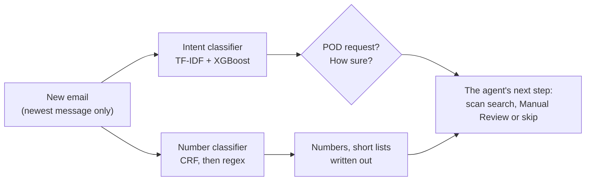
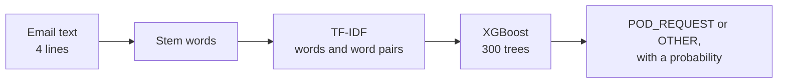
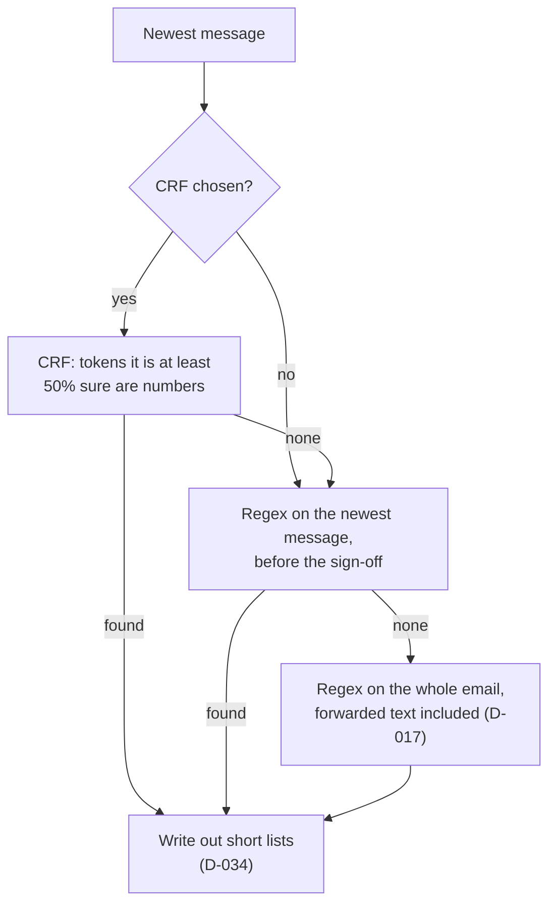

# Classifiers

The agent uses two classifiers on every email:

1. **The intent classifier** decides whether the email asks for a POD
   (`POD_REQUEST`) or not (`OTHER`), and how sure it is.
2. **The number classifier** finds the connote and reference numbers the
   email asks about.

Both train on the team's own labeled emails, run on the office PC's CPU,
and need no pretrained language model: the PC cannot download one (D-001,
D-021). A person chooses which trained model runs; training alone changes
nothing (D-011).



The code lives in `app/classifier.py` (intent), `app/number_classifier.py`,
`app/number_crf.py`, `app/entity_extractor.py` and `app/number_lists.py`
(numbers), and `app/model_registry.py` (choice, evaluation, history).

## 1. The intent classifier

### Input

The model reads four lines built from the email (`build_email_text`):

| Line | What goes in |
|---|---|
| `Subject` | The subject, cleaned (below) |
| `Sender` | `internal` for the company's own staff, else the sender's domain, so a new person at a known customer still counts as that customer |
| `To` | The recipients as they are, because which address the email went to is itself a signal |
| `Body` | The newest message only, with quoted replies and forwards cut off, cleaned (below) |

Cleaning (`normalize_text`, D-016) swaps one-off values for shared tokens.
Every connote, date and address is unique, so as raw words they teach the
model nothing; as tokens they say "a number, link or address is here":

- any word with a digit becomes `numtoken`;
- a URL becomes `urltoken`, an email address `emailtoken`;
- whitespace collapses and the text goes lower-case.

Then each word is stemmed with the Snowball English stemmer (`send`,
`sending` and `sends` all become `send`). An example, straight from the
code:

```text
Subject: POD request 1234567
Body:    Hi, please send the POD for 1234567 and 7654321.
         See https://x.example/a or mail ops@example1.com

becomes

subject: pod request numtoken sender: example1.com to: pod
body: hi, pleas send the pod for numtoken and numtoken .
see urltoken or mail emailtoken
```

### Model



- **TF-IDF** turns the text into a vector of single words and word pairs
  (`ngram_range=(1, 2)`), weighted by how rare each is across the emails.
- **XGBoost** is the model the agent uses: 300 trees, depth 6, learning
  rate 0.05, 80% of the rows and columns per tree.
- **Logistic regression** (class-balanced) trains alongside as a yardstick
  (D-024). If XGBoost ever drops to its level, the data needs a look.

The model returns a label and a **confidence**: the higher of the two class
probabilities.

### Decision

`POD_CONFIDENCE_THRESHOLD` (0.95 by default, set in the dashboard) says
when the model is sure. The agent then acts as a person would (D-044):

| The model says | Sure (confidence ≥ threshold) | Unsure |
|---|---|---|
| `OTHER` | No reply. With a number it shows as Other Intent; without, Skipped. | With a number in the text or attachments: Manual Review. Without: Skipped. |
| `POD_REQUEST` | The agent searches the scans and asks Power BI. | The same, but if a number turns out unknown, a person reviews the email instead of the team correcting the number. |

**Cold start.** While no intent model is chosen, or a class has fewer than
`POD_MIN_TRAINING_SAMPLES_PER_CLASS` (150) labeled emails, the agent trusts
no model: every email with a number goes to Manual Review.

### Training

`python -m app.classifier`:

1. Reads the training workbook. A row's label is its manual `intent_label`,
   or, where that is empty, a pseudo-label a person has confirmed.
2. Scores XGBoost and logistic regression with **stratified 5-fold
   cross-validation** (D-022): each email is predicted once, by a model
   that never saw it, so the scores show how the model does on new emails.
3. Fits each model on all the labeled emails and saves it.
4. Writes a history file with every email's prediction and confidence, so
   the dashboard can show precision and coverage at any threshold later.
5. Activates nothing. The product owner compares the runs in the Models tab
   and chooses.

**Pseudo-labels.** `python -m app.classifier --pseudo-label --threshold 0.95`
lets the active model suggest a label for unlabeled rows it is at least 95%
sure of. A suggestion becomes a training label only after a person confirms
it in the dashboard.

## 2. The number classifier

### Order of work

`number_classifier.extract_numbers` tries three readers in turn and keeps
the first that finds anything:



The regex is a safety net: a request is never left without a number the
regex can see. The last step catches forwards such as "please send the POD
for these" above a forwarded email that lists them.

### The CRF

A CRF (conditional random field, `sklearn-crfsuite`) labels a whole
sequence of tokens at once, so each label depends on its neighbours. That
is what lets it tell a connote from an invoice or a phone number by the
words around it (D-026).

The subject and the newest message are split into tokens, and each token
gets these features (`number_crf._features`):

| Feature | Example for `1234567` in "the POD for connote 1234567." |
|---|---|
| Shape, full and short (`9` for a digit, `A`/`a` for letters) | `9999999`, `9` |
| Length, digit count, all digits, has letters, has a hyphen | 7, 7, yes, no, no |
| Leading letters and first two characters | none, `12` |
| In the subject, first on its line, after a sign-off word | no, no, no |
| The two words before and after (numbers by their short shape) | `for`, `connote`, `.`, `regards` |

The CRF labels each token `CONNOTE`, `REFERENCE` or `O` (other). For a
token with a digit, the chance that it is a number is 1 minus the chance of
`O`; the agent keeps it when that reaches `POD_NUMBER_CONFIDENCE_THRESHOLD`
(0.5).

### The regex

`entity_extractor.extract_email_connotes` reads the text before the first
"Regards", so numbers in signatures stay out. A token counts when it is:

- 6 to 10 digits and does not start with `04` (a mobile number), or
- a prefix from `POD_CONNOTE_PREFIXES` followed by a digit or `-`, such as
  `AB-10234` with `AB` set (D-060).

### Short lists

Customers write several connotes at once. `number_lists.expand` writes them
out, but only around a number the reader already found, so "2/3 pallets"
or a date stays alone:

| Written | Read as |
|---|---|
| `7335842/843/844` | 7335842, 7335843, 7335844 |
| `7336101-103` | 7336101, 7336102, 7336103 |
| `4653685-01` | one connote, as written |
| `614024-610423` (second lower) | two numbers |
| A backwards or over-long range (more than 20) | not guessed: the email goes to the team |

### Training

`python -m app.train_number_classifier`:

1. Takes the `POD_REQUEST` emails whose connotes or references a person
   filled in, and marks every token `CONNOTE`, `REFERENCE` or `O` from
   those labels.
2. Cross-validates the CRF against the regex with 5 folds **split by
   email**, so one email's tokens never sit in training and testing at once
   (D-022). Splitting by token made a weak model look strong.
3. Compares them email by email: how many emails it got fully right, its
   precision and recall, and how many requests it left without a number.
4. Saves the CRF trained on all the emails, and writes a history file.
5. Activates nothing. The product owner keeps `crf` if its test row beats
   the regex, and can switch back to `regex` at any time.

## 3. Why these choices

| Choice | Reason | Decision |
|---|---|---|
| No pretrained language model | The PC cannot reach Hugging Face; a PyTorch network trained from scratch lost to XGBoost and the regex | D-021 |
| Numbers, links and addresses as tokens | Same F1, higher precision and coverage at the threshold | D-016 |
| XGBoost with a logistic regression yardstick | Best scores; the yardstick shows when the data, not the model, is the problem | D-024 |
| Cross-validation, split by email for numbers | Honest scores on emails the model never saw | D-022 |
| A CRF with a regex fallback | Reads numbers in context, and never leaves a request without a number | D-026 |
| A 0.95 intent threshold | In cross-validation, precision 0.971 at 0.95 against 0.943 at 0.90: wrong automatic handling roughly halves, while coverage drops from 55% to 45% of POD requests | D-025 |
| A person chooses the active model | The old automatic choice preferred the smallest train/test gap over the best test score | D-011 |
