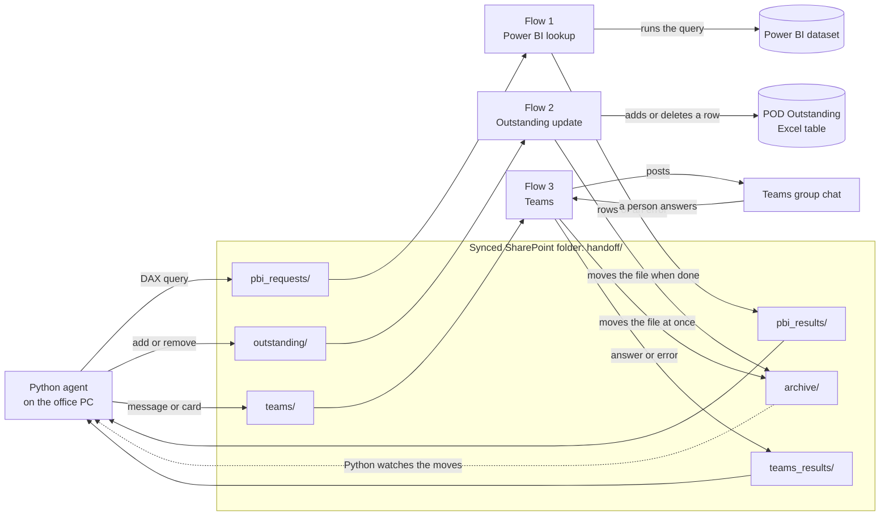
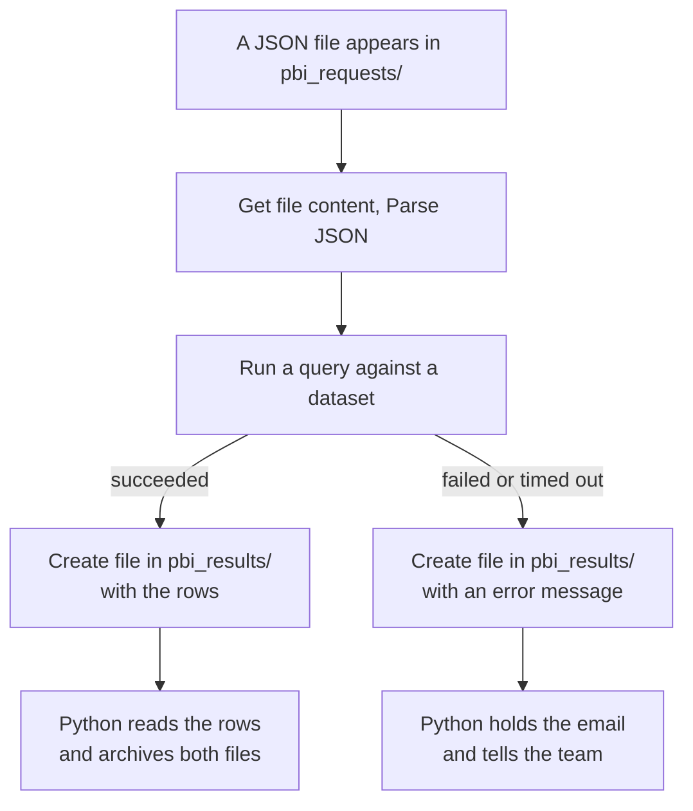
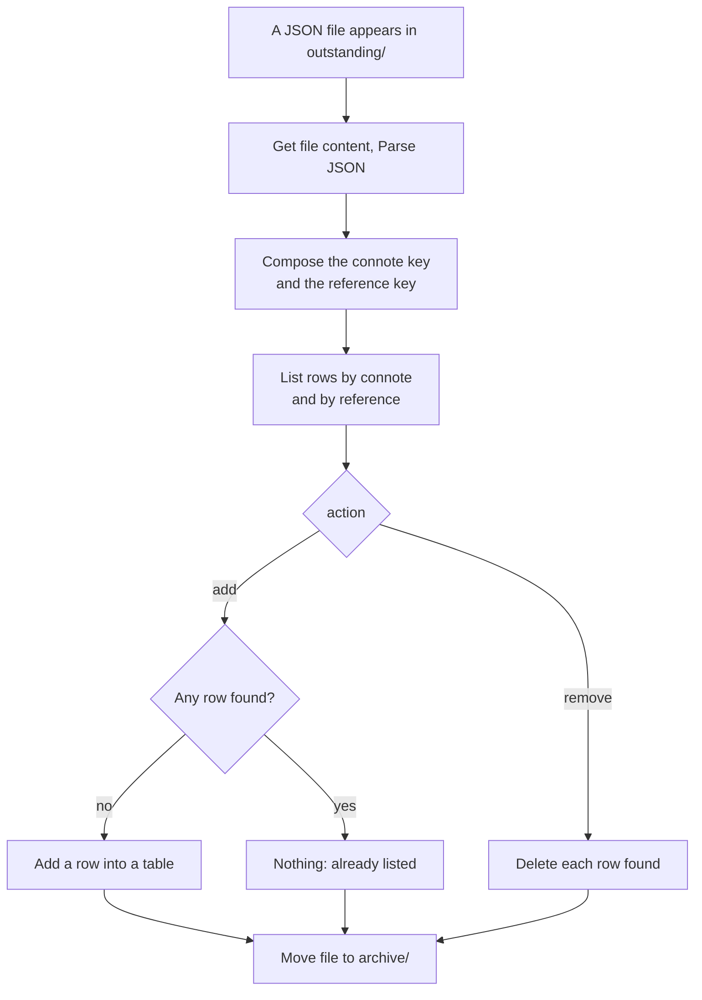
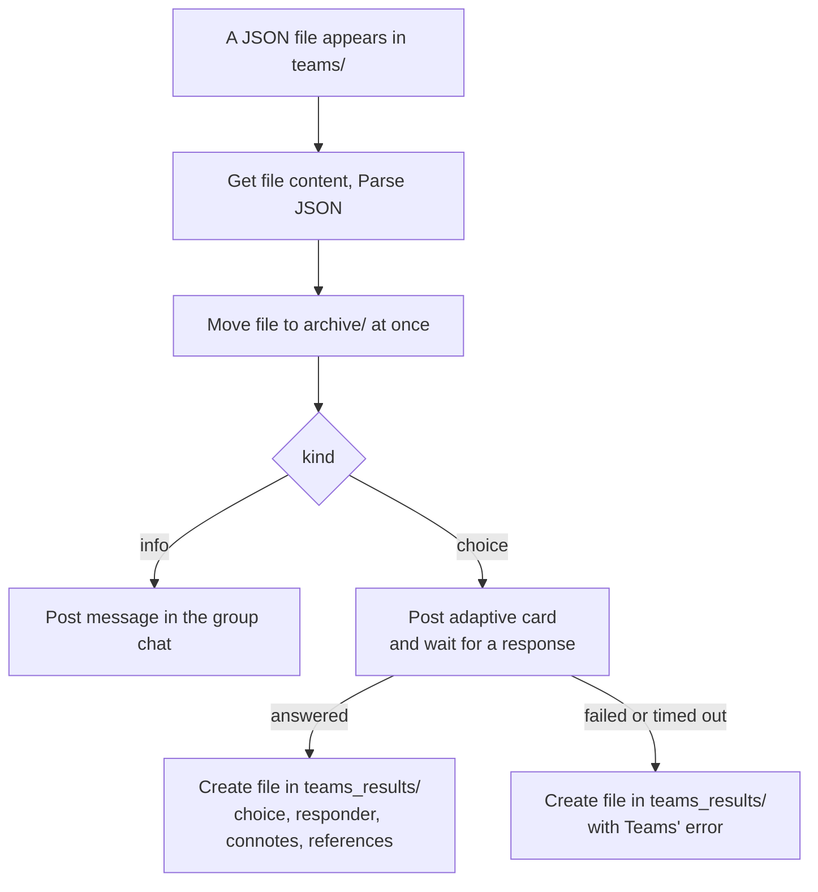

# Power Automate flows

The agent cannot reach Power BI, the POD Outstanding workbook or Teams
from the office PC (D-001, D-009). Three cloud flows do that for it. Python
writes one JSON file per message into a synced SharePoint folder. Each flow
starts when a file appears, does one thing, and writes one JSON file back
where an answer is needed.

The flows carry **no business rules**. Python builds the Power BI query,
the Outstanding row, and the Teams text and card; the flows only carry
them. Every connector is standard: SharePoint, Power BI, Excel Online
(Business) and Microsoft Teams.

| Flow | Starts on a file in | Does | Writes to |
|---|---|---|---|
| 1. POD Power BI lookup | `handoff/pbi_requests/` | Runs the DAX query | `handoff/pbi_results/` |
| 2. POD Outstanding update | `handoff/outstanding/` | Adds or removes a row | (moves the file to `archive/`) |
| 3. POD Teams | `handoff/teams/` | Posts a message, or a card and waits for the answer | `handoff/teams_results/` (cards only) |



Python and the flows never call each other: each side only writes files
into the synced folder and reacts to the other side's files. When a Power
BI request has no result after 30 minutes, or a Teams file still sits in
`teams/`, Python takes it that the flow did not run and writes the file
again, up to 3 times. Then the dashboard's Review queue warns a person
(D-037, D-049).

Every flow starts the same way: a SharePoint trigger on a new `.json` file
in its folder, then *Get file content* and *Parse JSON*.

## Flow 1: POD Power BI lookup

Python asks Power BI about the numbers that have no scan on the share.

```json
{
  "request_id": "3f2a9c0d1e4b5a67-p1",
  "entry_id": "<Outlook entry id>",
  "numbers": ["7777777", "SH123456789", "8888888"],
  "scan_missing_numbers": ["7777777", "SH123456789"],
  "query": "EVALUATE\nFILTER(\n    'POD Data',\n    ... )"
}
```

`numbers` holds every number the email requested; `scan_missing_numbers`
holds the ones with no scan, and Python builds `query` from those alone.
Each request has its own id (`<email id>-p<n>`, D-040), and Flow 1 names
the result file after it, so the agent never mistakes one request's answer
for another's.



The result is the query's rows as they come back, with keys such as
`POD Data[Connote]`; Python keeps the part in brackets and matches each
row to a requested number.

## Flow 2: POD Outstanding update

Python keeps the POD Outstanding list in step with the replies: it adds a
number not received yet, and removes a number whose scan just went out.

```json
{
  "request_id": "3f2a9c0d1e4b5a67",
  "action": "add",
  "number": "SH123456789",
  "connote": "7777777",
  "reference": "SH123456789",
  "row": {"<Excel column>": "<value>", "...": "..."}
}
```

For `add`, `POD_OUTSTANDING_COLUMNS` lays out `row`, and `connote` and
`reference` come from Power BI. For `remove`, only `number` is filled in,
as the customer wrote it.



The move to `archive/` is the signal that the change happened. Once every
`add` file for an email sits in `archive/`, Python gives the email the
Outlook category `On List`. A file left in `outstanding/` shows a change
that failed.

## Flow 3: POD Teams

Python tells the team about held emails and asks them questions through
adaptive cards it builds itself.

```json
{
  "request_id": "3f2a9c0d1e4b5a67-0",
  "kind": "choice",
  "message": "POD request from ... Number 555555 matches 2 files. Which should be sent?",
  "options": [{"id": "file:0", "label": "5555556_y.pdf | \\\\server\\POD\\2026\\5555556_y.pdf"}, {"id": "all", "label": "All files"}, {"id": "not_all", "label": "Not all"}, {"id": "manual", "label": "Handle manually"}],
  "card": {"type": "AdaptiveCard", "version": "1.4", "body": ["..."], "actions": ["..."]}
}
```

- `info`: a plain message about a held email, with no answer needed.
- `choice`: a finished adaptive card, in one of three forms:
  - a file choice, when a number matches several scans;
  - a correction card, when a number is unknown or a list cannot be read
    (D-036), with the numbers in an editable field;
  - a Manual Review card (D-048), with Connotes and References fields and
    the buttons POD request, Not a POD request and Handle manually.
- Every card has an **Open the POD mailbox** button that opens the POD
  mailbox in Outlook on the web (D-051, D-061). Listed files show their
  full path as text, because Teams users have no access to the share.



Flow 3 moves the file first, so a file still in `teams/` means the card
never left. A card stays open in Teams until someone answers, for up to 30
days. Meanwhile the email waits, and the agent goes on with other emails.

## Turning a flow off

Turning a flow off stops only that step. The agent keeps waiting and
carries on when the flow is back on. The `STOP` file stops the agent
itself.
