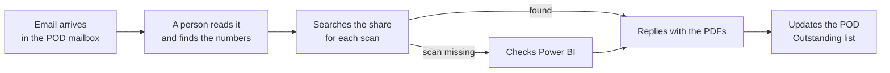
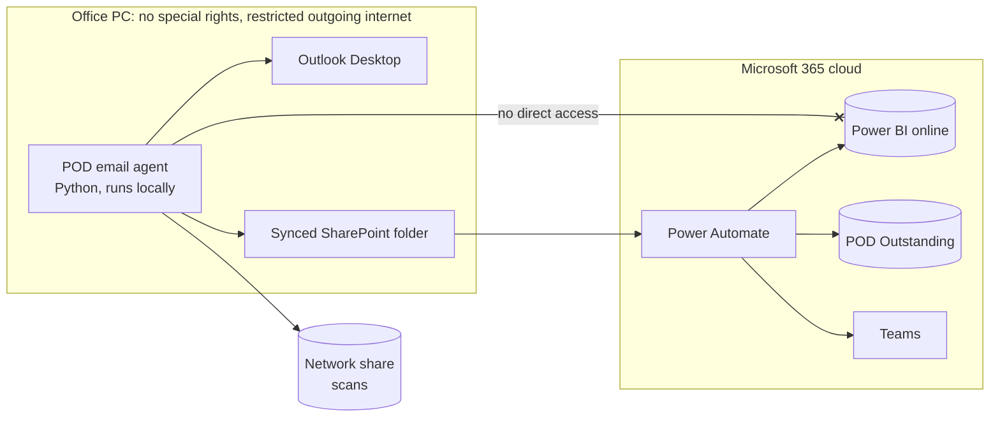

# PRD: POD Email Agent

This file says what the agent must do and why. The D-numbers point to
`docs/DECISIONS.md`, which records how each requirement was decided.
`docs/HANDBOOK.md` holds the facts about the environment and the safety
rules; `docs/ARCHITECTURE.md` shows how the agent is built.

## 1. Problem

Customers and colleagues email the POD mailbox for Proof of Delivery
documents, often with several connote or reference numbers in one email.
Today a person reads each email, finds the scanned PDFs on the network
share, checks Power BI when a scan is missing, replies, and updates the POD
Outstanding list. Most requests arrive in the morning, up to one every 15
minutes.

The agent must run on an ordinary office PC used by the administration
staff. The PC has no special rights and restricted outgoing internet
access. It runs Python, but it has no database or API connection to the
business's data. The agent is therefore a Python program that runs locally
and uses only what the PC already has (D-001, D-009):

- Outlook Desktop for the mailbox
- the network share for the scans
- Power BI online through Power Automate flows, which trade one JSON file
  per message with the agent in a synced SharePoint folder

## 2. Goals

- G1. Answer a POD request without a person when the answer is certain:
  send the scans that exist, and name the ones not received yet.
- G2. Keep the POD Outstanding list in step with the requests.
- G3. Never send a wrong answer. When unsure, hold the email and ask the
  team.
- G4. Let the product owner improve the models: label, retrain, compare,
  choose.

### Success measures

- Share of POD request emails answered without a person.
- Share of pilot drafts sent without edits.
- Share of system labels the product owner leaves unchanged (accuracy on
  real emails).
- POD_REQUEST precision at the chosen confidence threshold.

Pilot exit criterion (D-014, D-053, D-054): over the two-week pilot, the
team sends at least **90%** of the agent's drafts with the PODs it attached.
The team may change the text. The product owner sets the target in the
dashboard's Settings tab. The other measures have no target yet (section 8).

## 3. Users

| User | Needs |
|---|---|
| Requester (customer or colleague) | A fast, correct answer, and to know it comes from a machine |
| POD team (Teams group chat) | Enough detail on a held email to act; a card to pick a file from |
| Product owner (runs the agent) | A dashboard to label, train, choose models, run jobs and watch results |
| IT (later) | Clear docs to move the agent to a server |

## 4. Functional requirements

### Email intake

- R1. Process only emails that are unread in the POD mailbox and that the
  agent has not processed yet. (D-002)
- R2. After the PC has been off, the first run processes everything that
  arrived since the last good run. A dashboard button does the same on
  demand. (D-002)
- R3. Skip the POD mailbox's own messages, auto-replies, bounces and
  no-reply senders. (D-002)

### Reading the email

- R3a. An email with no connote or reference number is not a POD request.
  Log it and skip it. (D-015)
- R4. Classify each email that holds a number as `POD_REQUEST` or `OTHER`.
  Only a `POD_REQUEST` above the confidence threshold goes on; the agent
  logs the rest and leaves them to people. (D-011)
- R5. Send every email to manual review (cold start) while no model is
  trained, or while an intent class has fewer labeled examples than the
  minimum.
- R6. Extract every connote and reference number from the newest message,
  with quoted history removed. Use the CRF number model, and fall back to
  regex when it finds none (D-026). If the newest message holds no number,
  read the whole email, forwarded text included. (D-017)

### Finding the POD

- R7. Search every PDF under the scan folders set in `.env`, subfolders
  included. Clean the number and the file name the same way: remove
  spaces, `-`, `,` and `.`, and upper-case. A file matches when its name
  contains the number. (D-003)
- R8. One matching file: FOUND. More than one: AMBIGUOUS. (D-003)
- R9. No matching file: look the number up in the Power BI dataset, in the
  connote and reference columns. Present: NOT_RECEIVED, with its POD status
  and details. Absent: UNKNOWN. (D-004)

### Holding and asking the team

- R10. If any number in an email is AMBIGUOUS or UNKNOWN, hold the whole
  email and tell the Teams group chat the details. (D-006) Add an UNKNOWN
  number to POD Outstanding as "Not in The System" for the team to check.
  (D-023)
- R11. For AMBIGUOUS, the Teams card offers each file, all files, or
  "handle manually". When the team picks a file, the agent carries on.
  (D-006)
- R12. Held emails appear in the dashboard's review queue and stay unread
  in Outlook. (D-002, D-006)

### Replying

- R13. One reply per email. Attach every FOUND file; list every
  NOT_RECEIVED number as not received yet, to follow once it arrives.
  (D-005)
- R14. Open with "Hi,", say in every reply that the email is automated,
  write in English, and keep the template text in one place. (D-005)
- R15. During the pilot the agent saves replies as Outlook drafts. A
  dashboard setting switches to partial or full sending. A `STOP` file
  stops all drafting and sending. (D-008, D-057)
- R16. After replying, mark the email read. (D-002)

### POD Outstanding list

- R17. Remove FOUND numbers from POD Outstanding if they are on it. (D-007)
- R18. Add NOT_RECEIVED numbers that are not on it yet, with Power BI
  details mapped to column names set in `.env`. (D-007)
- R19. Send no follow-up email when a POD arrives later. Answer a repeat
  request from the state at that time. (D-007)

### Dashboard

- R20. Overview: KPI tiles, daily volume by outcome, outcome per requested
  number, weekly hit rate, agreement with system decisions, top requesting
  domains, and the age of the review queue. (D-012)
- R21. Review queue: held emails with their reason and Teams status.
  (D-012)
- R22. Labeling: edit labels in the table, search and filter, label in
  bulk, and see found numbers highlighted in the email body. Each label
  shows `System decision` or `Manual`. (D-012, D-013)
- R23. "Pull new data": the emails the agent processed, pre-labeled as
  `System decision`, plus mailbox emails it never processed, unlabeled.
  (D-013)
- R24. Models: accuracy, precision, recall, F1 and a confusion matrix per
  model; POD_REQUEST precision and coverage at a threshold set in the
  dashboard; training history; and a choice of active model per task.
  (D-011)
- R25. Jobs: buttons for the historical pull, pull new data, training and
  run once, each with visible progress. Two runs never overlap. (D-012)

## 5. Non-functional requirements

- N1. Run unattended on an office PC every 5 minutes, while the PC is on.
  (D-001, D-002)
- N2. CPU only: scikit-learn, a CRF and regex. No pretrained language model
  and no local LLM. (D-001, D-026)
- N3. Power Automate holds no business logic. It only reaches Power BI, the
  Outstanding workbook and Teams. (D-001)
- N4. A delay of a few minutes for the Power BI round trip is fine.
- N5. Record every email's path, and record errors as well as printing
  them. (D-010)
- N6. Keep all Outlook access in one module, `app/outlook_reader.py`.
  (D-001)
- N7. Keep site-specific names in settings, out of the code: folders, Power
  BI names, Outstanding columns, threshold, send mode.

## 6. Constraints

- The PC's outgoing internet access is restricted, so the agent runs
  locally, in Python. (D-001)
- The agent has no direct access to the business's data. It reads Power BI
  online only through Power Automate flows. (D-009)
- No Outlook API: Outlook Desktop only. (D-001)
- The POD Outstanding workbook does not sync to the PC. (D-007)
- No Azure resources or Microsoft Graph on the PC.

## 7. Out of scope

- Intents other than `POD_REQUEST`.
- Follow-up emails when a POD arrives later.
- Edits to Outstanding rows beyond adding and removing requested numbers.
- Running on a server (prepared for, not built).
