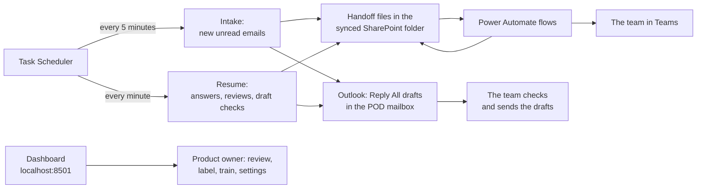

# Runbook

This file covers how the agent runs on the office PC: install, run,
schedule, daily use, stop, undo and fix. Run the commands in Windows
PowerShell, from the project folder. `docs/ARCHITECTURE.md` explains how
the agent works and lists every setting.

## How it runs day to day



The scheduled jobs run without a window. The team works in Outlook and
Teams; the product owner works in the dashboard. Replies stay drafts until
the product owner switches sending on.

## 1. Requirements

- Windows, with Outlook Desktop open and signed in, and the POD mailbox at
  the top level of the folder list.
- Python 3.13 or newer; the agent runs on 3.14. SQLite comes with Python.
- Read access to the POD scan folders, and the SharePoint library with the
  handoff folder synced to this PC.
- Send-as or send-on-behalf rights on the POD mailbox, since replies come
  from it.
- The three Power Automate flows (`docs/POWER_AUTOMATE_FLOW.md`), built and
  on.

## 2. Install and configure

```powershell
python -m venv .venv
.\.venv\Scripts\python -m pip install -r requirements.txt
.\.venv\Scripts\python -m unittest discover -s tests
Copy-Item .env.example .env
notepad .env
.\.venv\Scripts\python -m app.check_setup
```

The tests must end with `OK`. In `.env`, replace every `<...>` with the real
name; `docs/ARCHITECTURE.md` section 6 explains each setting, and
`check_setup` reports what is still missing. If PowerShell blocks scripts,
call `.\.venv\Scripts\python` as above instead of activating the
environment. After a `git pull`, run the `pip` and `unittest` lines again.

## 3. Train and choose the models

```powershell
.\.venv\Scripts\python -m app.historical_pull          # first time only
.\.venv\Scripts\python -m app.classifier
.\.venv\Scripts\python -m app.train_number_classifier
.\.venv\Scripts\python -m app.model_registry --task intent --activate xgboost
.\.venv\Scripts\python -m app.model_registry --task number --activate crf
```

You can also choose in the dashboard's Models tab. Activate `xgboost` if it
scores well above `logreg`, and `crf` if its test row gets more emails fully
right than `regex`. Then move the threshold slider to the lowest value with
a precision of at least 95%, and save it. Until you choose an intent model,
every email with a number goes to manual review.

## 4. Run and schedule

Once, by hand, with progress in the console:

```powershell
.\.venv\Scripts\python -m app.main
```

On a schedule, two Task Scheduler jobs run without a window: intake
(`--process-new`) every 5 minutes and resume (`--resume`) every minute.
They share one run lock. They run as you, only while you are signed in,
because Outlook needs that.

```powershell
$project = (Get-Location).Path
$pythonw = Join-Path $project ".venv\Scripts\pythonw.exe"
$intakeAction = New-ScheduledTaskAction -Execute $pythonw -Argument "-m app.main --process-new" -WorkingDirectory $project
$resumeAction = New-ScheduledTaskAction -Execute $pythonw -Argument "-m app.main --resume" -WorkingDirectory $project
$intakeTrigger = New-ScheduledTaskTrigger -Once -At (Get-Date).AddMinutes(1) -RepetitionInterval (New-TimeSpan -Minutes 5)
$resumeTrigger = New-ScheduledTaskTrigger -Once -At (Get-Date).AddMinutes(1) -RepetitionInterval (New-TimeSpan -Minutes 1)
$settings = New-ScheduledTaskSettingsSet -MultipleInstances IgnoreNew
Register-ScheduledTask -TaskName "POD Email Intake" -Action $intakeAction -Trigger $intakeTrigger -Settings $settings -Force
Register-ScheduledTask -TaskName "POD Async Resume" -Action $resumeAction -Trigger $resumeTrigger -Settings $settings -Force
```

Each cycle appends a summary line to `logs\run_log.txt`; a resume run
writes one only when it did something.

The dashboard:

```powershell
.\.venv\Scripts\streamlit run dashboard\app.py
```

Open http://localhost:8501; only this PC can reach it. Its Settings tab
switches replies between Off (drafts), Partial (sent to chosen domains) and
Full, and asks first whenever more replies would go out.

To clear the local history and start over, close the dashboard and the
jobs, then run `.\.venv\Scripts\python.exe -m app.main --reset`. It backs up
the two local state files first, and leaves Outlook, the models and the
training data alone.

## 5. Daily use

| You see | What to do |
|---|---|
| A draft in the POD mailbox's Drafts | Check it and send it. |
| A draft without attachments (files too large) | Attach the files from the SharePoint link in the Teams message, then send it. |
| A Teams card asking which file to send | Pick the file, all files, or "Handle manually". |
| A Teams card asking to correct numbers | Correct them and press Save numbers. Keep a number that is right; clear one that is not a POD number. |
| A Teams card for Manual Review | Fill in the connotes and references and press POD request, Not a POD request, or Handle manually. The dashboard's Review queue does the same, and the first answer counts. |
| A "Not in The System" row in POD Outstanding | Check the number. If it is not a POD number, take it out of the held email, and the agent removes the row. |
| A warning in the Review queue | A flow did not answer after 3 tries. Check that flow's run history, then press **Reprocess in Power BI** or **Send Teams card again**. |

An email the team answers or files by hand in Outlook becomes Resolved, and
the agent makes no draft for it. The Overview tab shows the pilot measure:
the share of drafts sent with exactly the PODs the agent attached.

## 6. Stop and undo

| To | Do |
|---|---|
| Stop everything now | Create an empty file `STOP` in the project folder, or press Stop the agent in the Settings tab. Remove it to resume. |
| Stop sending, keep drafting | Choose Off under Automatic replies in the Settings tab. |
| Stop one Power Automate step | Turn that flow off. The agent keeps waiting and carries on once it is back on. |
| Stop the schedule | `Disable-ScheduledTask -TaskName "POD Email Intake", "POD Async Resume"`; `Enable-ScheduledTask` resumes it. |
| Undo a code change | `git revert <commit>`, then the update steps in section 2. |
| Go back to an earlier model | Choose it in the Models tab, or retrain. `models\history\` keeps every run's scores. |

Stopping loses nothing: the status log lives in `data\tracking.db`, the
handoff files go to `handoff\archive\`, and the history only grows.

## 7. Problems

| Symptom | Cause | Fix |
|---|---|---|
| `Outlook mailbox/folder not found` | `POD_OUTLOOK_MAILBOX` differs from the name in Outlook's folder list | Copy the name exactly from Outlook. |
| The log says `stopped_by_STOP_file` | A `STOP` file exists | Delete it, or press Remove STOP in the Settings tab. |
| The log says `skipped_already_running` every run | An earlier run is stuck | Close stuck `python.exe` processes in Task Manager. |
| The log says `share_unavailable` | The agent cannot reach a scan folder | Check that `POD_SCAN_FOLDERS` opens in File Explorer. The agent retries next run. |
| Every email goes to Manual Review | No intent model chosen, or too few labels | Section 3. |
| Emails stay "Waiting Power BI" | Flow 1 is off or failing, or the folder does not sync | After 3 tries the Review queue shows the Request ID. Find it in Flow 1's run history and check the OneDrive sync icon, then press **Reprocess in Power BI**. |
| Emails stay "Waiting Team", or no card appears | Flow 3 did not take the card, or Teams refused it | After 3 tries the Review queue shows the Request ID and the reason. Find it in Flow 3's run history, then press **Send Teams card again**. |
| `ConfigError: Setting POD_... is missing` | A required setting is empty | Fill it in `.env`. |
| `pip install` fails | An old pip, or a package without a build for this Python | Run `.\.venv\Scripts\python -m pip install --upgrade pip` and install again. |
| The training workbook is locked | It is open in Excel or still syncing | Close it, wait for the sync, and run again. |

## 8. Data and security

- Never commit `.env`, `data\`, `logs\`, `models\` files, training data,
  tracking, attachments or handoff files; `.gitignore` covers them.
- The dashboard listens on this PC only (`.streamlit\config.toml`).
- If a credential ever gets committed, change it and clean the history.
