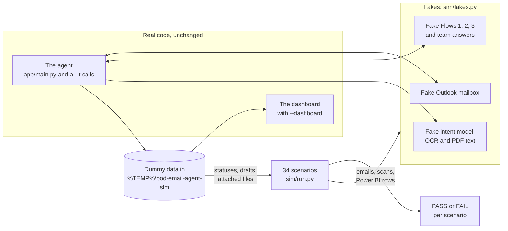

# Simulation

The simulation runs the real agent code end to end against a fake Outlook,
fake Power Automate flows and dummy data, on any Windows PC with the project
installed. The unit tests check each part on its own; the simulation checks
that the parts work together. Production still needs its own test (see "Not
covered").

## Run it

```powershell
.\.venv\Scripts\python -m sim.run
.\.venv\Scripts\python -m sim.run --dashboard   # then open the dashboard on the simulated data
```

A run takes about 15 seconds. It prints one line per scenario, `PASS` or
`FAIL` with what happened, then a summary, and exits with code 1 when a
scenario fails. It writes the same report to `report.txt` in the simulation
folder.

### The dashboard with demo data

With `--dashboard`, after the scenarios, `sim/demo.py` fills the simulation
with a month of demo data, then the dashboard opens at
http://localhost:8501. This takes about half a minute more:

- about 370 dummy POD emails over the last 30 days, 15 to 20 a weekday and a
  few at weekends, mostly in the morning, with a realistic mix of outcomes:
  files sent, not received yet, chosen by the team, handled by hand, not a
  POD request, and a few still waiting;
- what became of each draft (sent with the same PODs, PODs changed,
  deleted), so the pilot measure has figures;
- the scenario emails, moved onto earlier days of the month;
- a training workbook of labeled dummy emails, and weekly "Pull new data"
  runs of the agent's decisions, mostly confirmed by the product owner;
- intent and number models trained twice on that workbook with the agent's
  own training code, and the pseudo-labels of the active models.

The history goes through the agent's own `tracking.record`, with the clock
set back to each event's time. The demo data is for looking at; the
scenario checks never see it, and CI runs `python -m sim.run` without it.
Do not press the Jobs tab's buttons or "Open in Outlook" on the simulated
dashboard: they are not simulated.

## What is real and what is simulated



| Part | In the simulation |
|---|---|
| Agent code (`app/main.py` and everything it calls: number reading, scan search, Power BI query and matching, replies, holds, Teams cards, POD Outstanding, tracking) | **Real**, unchanged |
| Dashboard (`--dashboard`) | **Real**, reading the simulated data |
| Outlook | Fake mailbox (`sim/fakes.py`, `FakeMailbox`): unread emails and their attachments, the drafts the agent makes, Outlook's "You replied" mark for an email answered by hand, and emails moved or deleted by hand (with a new entry ID or the old one) |
| OCR and PDF reading | Fake: each attachment's text is set by its scenario; the real Windows OCR and PDF reader are tested in `tests/test_attachments.py` |
| Scan folders | Dummy PDFs, generated each run |
| Power BI and Flow 1 | Fake: answers each request from a small dummy table, optionally a few runs late, or late and empty for a first request |
| Flow 2 (POD Outstanding) | Fake: keeps the rows in memory, adding only if absent |
| Flow 3 (Teams) | Fake: takes each file at once (as `docs/POWER_AUTOMATE_FLOW.md` says), "posts" it, and answers cards as each scenario says; it can leave a card's file untaken, as when the flow does not run |
| Intent model | Fake: a remittance email is OTHER, anything else a POD request at 97%, or 60% (below the threshold) with "maybe" in it |
| Number model | None: the regex extractor, as with no number model chosen |
| Time | Runs about a second apart; "30 minutes" for Teams cards is made 1 second |

## Where the data goes

The simulation writes everything to `%TEMP%\pod-email-agent-sim`, outside
the project, and clears that folder at the start of each run. Before
anything runs, it points the agent's paths there: tracking database, handoff
folders, scan folders, logs, models, training data, and the `.env` for
dashboard settings. It never reads or writes your real data, `.env`, Outlook
or SharePoint. Every email, number, name and file is made up, and the
repository holds no customer data.

## Scenarios

| ID | Scenario | Expected |
|---|---|---|
| S01 | Scan on the share | Draft with the PDF |
| S02 | Short-form list `7335842/843` (D-034) | Draft with both PDFs |
| S03 | Two signed scans of one number (`Signed`, `Signed (2)`); the team picks one on the Teams card (D-006, D-042) | Draft with the chosen PDF |
| S04 | Not on the share; Power BI says Unsigned (D-004) | Draft saying not received; POD Outstanding row Unsigned |
| S05 | Invoice number next to a connote: held; the team takes it out on the Teams card (D-035, D-036) | Draft with the connote's PDF; the "Not in The System" row removed |
| S06 | Number list that cannot be read: held; the team types the numbers on the card | Draft with both PDFs |
| S07 | Files too large to attach (2 MB, over a 1 MB limit), one number found and one not received (D-038, D-050) | A Reply All draft without the file; the Teams message lists each number with the SharePoint link; POD Outstanding row Unsigned; the team attaches the copy and sends the draft; the copy is then deleted |
| S08 | Answered by hand in Outlook while waiting for Power BI, whose answer comes late (D-039) | Resolved, "replied manually in Outlook"; no draft; the late result archived |
| S09 | Not a POD request | Manual Handling - Other Intent; no draft |
| S10 | Automatic reply | Skipped by the guard (D-002) |
| S11 | Teams card never taken by Flow 3 (D-037) | Posted again 3 times, then reported as not reaching Teams; after Send Teams card again with Flow 3 working, answered and drafted |
| S12 | Reference number: Power BI gives the connote, whose scan is on the share | Draft with that scan |
| S13 | A customer whose Power BI row gives the path of its signed scan (its scan path column) | Draft with that exact file |
| S14 | Number matches two files; the team answers "Not all"; Power BI says Unsigned | Draft saying not received; POD Outstanding row Unsigned |
| S15 | Reprocessed in Power BI from the dashboard; Flow 1's run for the first request finishes late and finds nothing, before the second request is answered (D-040) | Only the second request's answer is read: draft saying not received, POD Outstanding row Unsigned; the late answer archived unread |
| S16 | Waiting for the team's file choice; a person files it in Actioned/Finished, and Outlook gives it a new entry ID (D-041) | Resolved, "moved to Actioned/Finished in Outlook", found by its Internet Message ID; no draft |
| S17 | Waiting for Power BI; a person moves it to another folder (D-041) | Held, "moved to Customers in Outlook", for the team; no draft; the late Power BI answer archived |
| S18 | Not a POD request; a person files it in another folder (D-041; Other emails may go anywhere) | Resolved, "moved or deleted in Outlook" |
| S19 | Scan names as on the share: `7000003-80600001 - Signed` asked by its reference, `7000006 - Signed` beside `7000006.` and `7000006 - Unsigned`, and a pallet number `PLT70000061J` holding the same digits (D-042) | Draft with the reference's scan and the signed one only |
| S20 | A POD request with no number in its text: the PDF attachment's name has an unknown number, the attached picture has one on the share (D-044) | Draft with the picture's scan; numbers read from the picture |
| S21 | A connote and its reference in one email, the reference's connote being that connote (D-044) | Draft with the scan attached once, "for 3000021 (your reference 80600021)" |
| S22 | Two signed scans of one number; Power BI's scan path names one (D-044) | Draft with that scan, no Teams card |
| S23 | A customer in `POD_PBI_SENDER_CHECK`: its reference is in Power BI under its name, the connote's scan in its folder (D-044) | Draft with that scan |
| S24 | A POD request with no number in its text or attachments (D-044) | Manual Review |
| S25 | A POD request below the intent threshold whose scan is on the share (D-044) | Draft with that scan |
| S26 | A POD request below the intent threshold whose number is nowhere (D-044) | Manual Review with a review card (D-048), no correction card, no POD Outstanding row |
| S27 | Two numbers: one has its scan, Power BI does not know the other; the team keeps that number on the card, which asks only about it (D-045) | Draft with the found scan and a line that the other number is not in our system; POD Outstanding row Not in The System; no second card |
| S28 | As S27, but the team changes the number on the card to another that Power BI does not know either, then keeps that one (D-045) | A second card asking only the new number; then a draft with the found scan and a line that the new number is not in our system; POD Outstanding row Not in The System for the new number, the old one's removed |
| S29 | A POD request whose numbers are only in an Excel list, beside an Invoice column (D-046) | Draft with the scans of the Con Note column, its short list written out; the invoice number not read |
| S30 | A POD request with no number anywhere, saved in the dashboard as a POD request with the number fields empty (D-046) | Its attachments read again; none: back to Manual Review |
| S31 | Maybe not a POD request, with a number: Manual Review; the team answers the Teams review card as a POD request, with a connote and a reference (D-048) | Draft with both scans; the reference found through Power BI |
| S32 | Maybe not a POD request: Manual Review; the team answers Not a POD request on the card (D-048) | Reviewed - Other, nothing sent |
| S33 | A POD request whose text has only a wrong number (an invoice) that Power BI does not know, the right connote in an attachment's name (D-056) | Draft with the attachment's connote's scan; the text's number neither in the reply nor in POD Outstanding |
| S34 | The simulation runs in partial send mode with one chosen domain; an email from it, its scan on the share (D-057) | Sent directly; every other scenario's reply is a draft |

Between runs the simulation acts as a person would. It sends the S08 reply
by hand, presses Reprocess in Power BI for S15, files S16 to S18 in other
folders, and marks S07 Resolved once it is held. For S11, once the card is
reported, it "fixes" Flow 3 and presses Send Teams card again.

## Not covered

These need production; "Testing in production" in `docs/TEST.md` covers them:

- Outlook itself: opening emails, saving drafts in the POD mailbox's own
  Drafts folder, sending as the POD mailbox, and whether Outlook (desktop,
  web, mobile) sets the "You replied" mark and its time.
- Power Automate, Teams and SharePoint: whether Flow 3 posts cards and
  writes answers and error files, whether Flow 1's DAX query runs against the
  real dataset, whether the SharePoint link opens the folder.
- The real dataset's column names and values, the real scan share, and the
  trained models' predictions.
- The dashboard's buttons that call Outlook (Open in Outlook).

## Adding a scenario

Add a `Scenario` to `_scenarios()` in `sim/run.py` with the email, the
dummy scans it needs, its Power BI rows, the team's answer to its card, and
the expected status and attached files. A `check` function can test
anything else; `World` holds the mailbox, the flows and what the simulation
saw between runs. Use made-up names and numbers only.
