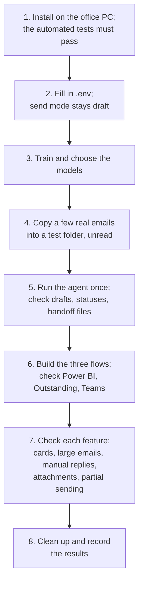

# Testing

This file explains how the agent gets tested: two kinds of tests that run on
any PC, and the testing that only production can do.

## Three kinds of testing

| Kind | Where | What it checks | How to run it |
|---|---|---|---|
| **1. Automated tests** | `tests/` | Each part on its own: reading numbers, matching scans, the Power BI query, Teams cards, replies, the dashboard. A fake Outlook and temporary folders stand in for the real ones, so the tests need no Outlook, network share or Power Automate. | `python -m unittest discover -s tests`. GitHub runs them on every push, on Python 3.13 and 3.14. |
| **2. Simulation** | `sim/`, described in `docs/SIMULATION.md` | The whole workflow, from an email arriving to the reply: the share, Power BI, Teams cards and what people do in between, with a fake Outlook, fake flows and dummy data. | `python -m sim.run`. GitHub runs it after the tests, on the same Python versions. |
| **3. Testing in production** | The office PC, below | What fakes cannot check: the real mailbox in Outlook, the scan share, Power BI and the Power Automate flows, Teams, real emails. | By hand, in the stages below, safest first. |

Run 1 and 2 after every change; they need only the project, and GitHub
runs both on every push. Run 3 once on the PC that runs the agent, and
again for each new feature.

## Testing in production

| Stage | What it shows |
|---|---|
| 1. Install | The PC can install the dependencies and run Python, scikit-learn and SQLite. |
| 2. Settings | Every `.env` setting points at a real folder, mailbox, Power BI table and workbook column. `python -m app.check_setup` reports the gaps. |
| 3. Models | The models trained on real emails beat their yardsticks: XGBoost over logistic regression, the CRF over the regex. |
| 4. Test folder | The agent works on copies, so real emails stay as they are. |
| 5. First run | Each kind of email ends where it should: a draft with the PDFs, Waiting Power BI, Waiting Team, or no reply. Each draft is a Reply All in the POD mailbox, with the signature and the original email trail. |
| 6. Flows | Each flow takes its file, does its one job and writes its answer; a broken flow makes the agent resend and then warn in the dashboard. |
| 7. Features | The paths the simulation covers with fakes also work against the real Outlook, Teams and SharePoint. |
| 8. Clean up | The test drafts are deleted, `.env` points at the real mailbox again, and the results are recorded without any email content or customer data. |

Three rules keep the test safe:

- Replies stay Outlook drafts (`POD_SEND_MODE=draft`) until the pilot
  passes, so no customer receives anything during the test.
- The agent marks read every email it answers, so the test uses copies in
  a separate folder.
- An empty file named `STOP` in the project folder stops the agent at any
  time.
